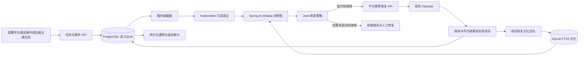
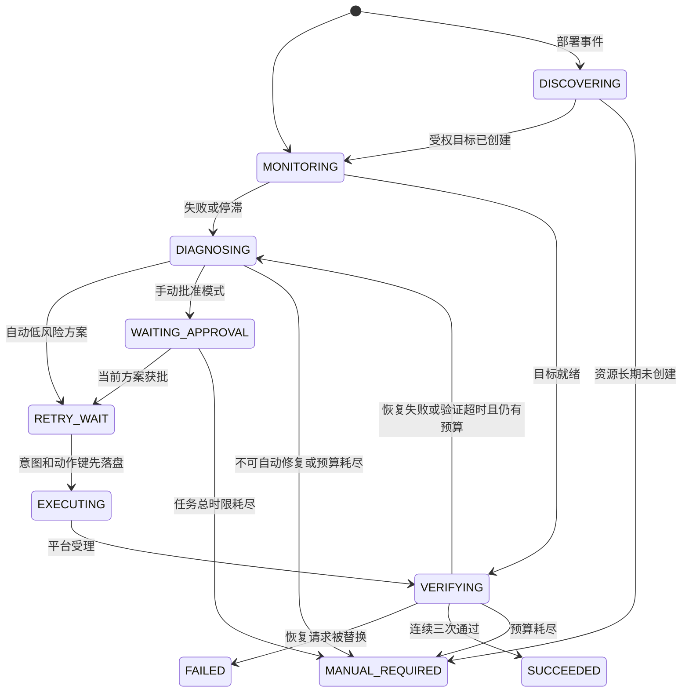

# 部署运维 Agent

独立 Java 项目，监控现有 Kubernetes / webapp-operator 的部署资源，在故障或阶段停滞后生成排查方案，通过平台恢复入口执行有界重试，并验证目标版本、平台任务和应用健康。

项目目标、完整业务流程、Graph、控制台、存储与整体验收见 [项目 PRD](feature/部署运维/部署运维Agent项目_PRD.md)；各模块详细规则从该文档导航进入。

## 站点开通与按范围托管

新增“站点开通”入口：在 CR 创建前记录平台阶段与错误，查看时间线、依赖、观察降级、自动调查和关联恢复。按明确工作空间、站点或项目、连接和已纳管 namespace 配置 OBSERVE / DIAGNOSE / APPROVAL / AUTO_LOW_RISK，默认沿用手动行为。APPROVAL 必须批准当前方案；暂停策略停止新动作，已受理动作继续只读对账。人工、事件和自动转交复用同发布账本与原预算。

阶段 v1 协议与低风险自动执行默认关闭，需平台提供独立阶段流及当前阶段读取接口；旧目录不能代替此协议。本轮未更新本机运行服务或执行真实恢复。配置、平台契约及 P0 验收表见[接入说明](docs/站点阶段协议与自动托管接入.md)，产品边界见[站点开通与自动托管 PRD](feature/部署运维/站点开通与自动托管_PRD.md)。恢复效果页区分自然收敛与受控恢复验收成功，不将建议视作已验证经验。

## 自动发现部署，用户选择 Agent 排查

发现记录也是调查案例：详情聚合方案、证据、对话与关联恢复。在严格 Kubernetes 模式下，可预览平台完整目标后确认转交；需要同集群独立执行身份和服务端验收目录。案例可批准当前低风险方案或停止尚未下发的恢复，重复转交复用原 Run 与预算。平台侧严格契约是接入依赖，详情会明确显示阻断原因。


先保存 KubeSphere 连接，再进入「部署任务」保存目标应用所在的监控 namespace 清单，为该连接点击“启用发现”。后台每 30 秒调度读取四类 webapp-operator CR，首次同步收录当前清单，同一 UID / generation 去重，新代次单独记录；可以“立即同步”。Token 需有目标命名空间中四类 CR 的 `get/list` 权限，Pod 测试成功不代表 CR 权限已满足。每个连接可在部署任务页独立选择 1–20 个明确命名空间，不使用通配符或全局扫描。

发现记录默认“待接管”，用户可“忽略”或“交给 Agent”。后者后台生成只读排查方案，并可从“详情 / 方案”查看，或“询问 Agent”继续对话；未选择时不调用模型。此入口不执行 kubectl、重试或集群修改，也不会把只读连接当作恢复身份。下方“已接入恢复流程”继续使用现有平台注册与预算策略。详细状态、接口与边界见 [部署发现与手动接管 PRD](feature/部署运维/部署发现与手动接管_PRD.md)。

Agent 对话可查看安全连接目录；在右侧选择连接后默认勾选“自动只读排查”。发送时通过该连接实际执行只读 Graph，采集异常 Pod 容器状态、事件、当前及上次退出日志，再由模型分析；可指定 Pod 名称继续，或关闭采证。每轮可展开“本轮集群采证记录”核对实际 API 请求和证据，模型失败不丢失已采集结果。403 会显示具体缺少的资源权限。无需本机 kubectl，不会自动切换环境、写资源或授予权限。详见[对话只读排查 PRD](feature/部署运维/对话只读排查_PRD.md)。

控制台模型读取超时默认 45 秒，可用 `AGENT_MODEL_READ_TIMEOUT` 配置为 100ms–45s，始终单次尝试。LLM 失败显示本地分类（如 `LLM_TIMEOUT`、`LLM_RATE_LIMIT`、`LLM_MODEL_UNAVAILABLE`）及可用 HTTP 状态，不回显上游正文或凭据；服务端记录安全分类和耗时。失败消息可点击“重新提问”填回输入框，确认发送才发起新请求。原 requestId 重放仍返回原结果，不自动重试。

## 技术选择

| 组件 | 版本与用途 |
| --- | --- |
| Java | JDK 21 LTS，独立进程运行，不要求升级现有 JDK 11 Operator |
| Spring Boot | 3.5.10，与所选 Alibaba Starter 发布 POM 对齐 |
| Spring AI Alibaba | 1.1.2.4-security-fix，使用 Graph Core 和 DashScope Starter |
| Spring AI | 1.1.2，由 BOM 统一依赖 |
| Kubernetes 客户端 | Fabric8 7.4.0，只读采集 |
| 数据库 | 默认 PostgreSQL 17；可选完整 SQLite 模式（Xerial JDBC 3.53.2.1），含任务、配置、对话和 FTS5 排障记忆 |

依赖版本以 Maven Central 已发布 POM 为依据，不采用 2.0 的里程碑版本。这个版本固定是兼容性起点；正式上线仍需按组织要求进行依赖漏洞扫描。

## 架构



诊断图真实使用 `StateGraph`，节点为 `sanitize → classify → recallMemory → generateCommands → assessCommands → executeCommands → analyzeResults → diagnose`：脱敏、规则分类、历史记忆召回、生成结构化命令、安全分析、受控采证、结果分析、最终诊断。分类先于记忆召回，历史建议不能扩大动作权限。可选的只读命令先保存审计再执行；恢复副作用继续由持久化状态机处理，重启后从任务状态继续。

Java 策略决定动作，模型补充原因假设、检查步骤、修复步骤和验证方式，也可生成结构化的只读命令计划。模型没有任意 shell、自由 kubectl 参数、数据库写入或 Kubernetes 写入工具。独立 Java 安全检查通过后才执行白名单采证。日志中的指令不会获得执行权限，模型失败回退规则手册或固定命令模板。

## 当前实现范围

- 每个任务绑定一个平台 `provisioningId`，以及 1–10 个**已存在**的 CR：`ProjectPostgres`、`ProjectRuntime`、`PlatformRelease`、`ServicePublish`。
- API 注册后自动轮询；也支持持久化部署事件，在 DISCOVERING 阶段从平台受权快照绑定新建 CR。明确失败或连续 10 分钟无进展触发诊断；不扫描平台全量任务。
- 采集 CR 状态，以及沿 ownerReference UID 关联的 Deployment、StatefulSet、Job、ReplicaSet、Pod、事件和有界日志。每个目标最多 4 个 Pod，每容器最多 60 行 / 4096 字节日志，最多 15 条事件。Helm 创建但没有 CR 所有权链的中间件 Pod 不纳入日志采集，不能据此宣称完成中间件协议诊断。
- 当前代次 CR 的明确网络超时、DNS 暂时失败、HTTP 429 / 503 / 504 可作为暂时性证据；认证、配置、OOM、容量、存储和数据错误优先转人工。证据包含来源、UID、代次、采集时间和缺口。可选采集失败保留已有证据并禁止自动恢复；历史日志或普通数字 503 不足以自动重试。
- 自动恢复只调用平台现有恢复 API，保持源配置不变。默认最多发起 2 次恢复意图，可配置为 1–3 次。不会通过反复生成新令牌无限重置 Operator 的三次 Job 失败预算。
- 未知原因、配置错误、资源不足和涉及数据的修复输出方案并进入 `MANUAL_REQUIRED`；修改配置、发布新镜像、扩容和回滚由正常变更流程完成，再用新请求键和新目标快照注册任务。本版本不自动修改源代码、配置、认证、PVC，也不自动执行数据库回滚。
- `AGENT_AUTO_RETRY=false` 时，低风险方案进入 `WAITING_APPROVAL`，批准接口必须携带当前 `planId`；过期方案不能执行。高风险方案无法通过批准接口变为自动执行。
- 严格模式成功要求绑定 CR 当前代次全部 Ready、平台任务 SUCCEEDED、本次恢复身份 SUCCEEDED，以及任务验收目录返回 HTTP 成功和 `{"status":"UP","version":"绑定发布版本"}`，连续满足 3 次检查。
- 低风险方案绑定 `platform-transient-retry` v1 手册，执行器、前置条件、验证与补偿均在代码目录定义；模型不能创建执行类型。
- 等待批准和终态在同一事务写通知出队事件，支持 HMAC 签名、失败退避、固定身份去重、DEAD 状态和人工重投。默认不向外投递。审计事件另表追加，不随任务快照的 100 条裁剪丢失。

## 本地启动

### SQLite 单机启动（无需 PostgreSQL）

```powershell
# 使用 JDK 21；构建包含真实 SQLite 文件集成测试
mvn -s settings-central.xml verify
java -jar target/deployment-ops-agent-0.1.0-SNAPSHOT.jar --spring.profiles.active=sqlite
```

打开 [管理页面](http://127.0.0.1:8098/)，本机演示账号 `operator` / `demo-local-only`。此模式把任务、事件、审计、通知、LLM 设置、KubeSphere 连接、聊天及排障记忆存入 **`./data/agent.db`**；无需配置 `DATABASE_*`。可用 `AGENT_SQLITE_FILE` 或 `--agent.sqlite.file=绝对路径` 指定文件。启用真实模式时，集群和平台凭据等要求仍须满足。

SQLite 使用 WAL、外键和 IMMEDIATE 写事务，适用于**本地持久盘、单机单实例**；不要将数据库放入共享网络盘或供多个 Pod 使用。任务认领和过期租约仍有数据库保护。SQLite 写入串行，不能按 PostgreSQL 的多实例并发容量理解。

停止服务后配套备份数据库和凭据主密钥；在线备份请使用 SQLite backup API，不能只复制正在写入的 `.db` 而遗漏 WAL。Docker 运行须挂载 `/app/data` 并允许 UID 10001 读写。切换存储不会搬迁数据，**当前没有 PostgreSQL → SQLite 自动迁移**；原 PostgreSQL 配置和会话仍在原库。

### PostgreSQL 启动（默认）

先确保 Maven 使用 JDK 21。机器上 `java -version` 为 21 并不代表 `mvn -version` 也使用同一 JDK，请以两者输出为准。

```powershell
cd D:/codes/deployment-ops-agent
docker compose up -d postgres
mvn -s settings-central.xml verify
java -jar target/deployment-ops-agent-0.1.0-SNAPSHOT.jar
```

默认监听 `127.0.0.1:8098`。默认 DEMO 模式使用真实 PostgreSQL 和模拟部署对象，不需要 Kubernetes、平台 Token 或模型密钥。默认演示账号为 `operator` / `demo-local-only`，数据库默认口令仅供本地演示。

打开 [Agent 管理页面](http://127.0.0.1:8098/)，使用上述演示账号登录，即可访问 Agent 对话、排障记忆、KubeSphere 连接、LLM 设置和部署任务。静态页面随 Jar 提供，无需安装 Node.js 或启动前端服务。生产账号通过 `AGENT_API_USERNAME` / `AGENT_API_PASSWORD` 注入，并由 HTTPS 反代提供访问。

另开一个 PowerShell：

```powershell
./scripts/demo.ps1
```

脚本创建任务并观察 `MONITORING → DIAGNOSING → RETRY_WAIT → EXECUTING → VERIFYING → SUCCEEDED`。演示过程中会生成中文诊断、固定动作幂等键、恢复身份和审计事件；不是实际集群恢复。

自有 PostgreSQL 可使用 `DATABASE_URL`、`DATABASE_USER` 和 `DATABASE_PASSWORD`，数据库须提前创建，表由 Flyway 管理。

## 启用模型诊断

推荐在页面「LLM 设置」中保存 Base URL、模型、API Key，并启用和测试连接。支持两种协议：

模型名称旁的“获取模型”会按当前填写的地址与 API Key 读取模型目录，随后可从下拉框选择，也可继续手工填写。无需先保存配置；密钥留空时仅能复用同一地址与协议的已保存密钥，更换目标需重新输入。获取列表不保存配置、不调用推理；选择后点击“保存配置”，再“测试连接”确认上游账号实际支持该模型。网关目录可能包含账号无法调用的模型。目录不可用或为空时仍可手填。

| 协议 | Base URL 示例 |
| --- | --- |
| DashScope 原生 | `https://dashscope.aliyuncs.com` |
| OpenAI 兼容 / 百炼兼容 | `https://dashscope.aliyuncs.com/compatible-mode/v1` |

保存后对话和后续 Graph 诊断热生效。页面配置优先于启动环境；明确关闭页面模型会让诊断使用规则手册。对话无模型时显示规则助手，启用模型后才进行自由问答。启动环境方式仍支持尚未保存页面配置的诊断：

```powershell
$env:AGENT_AI_ENABLED='true'
$env:AI_CHAT_PROVIDER='dashscope'
$env:DASHSCOPE_API_KEY='<通过安全配置注入>'
$env:DASHSCOPE_MODEL='qwen-plus'
java -jar target/deployment-ops-agent-0.1.0-SNAPSHOT.jar
```

上述环境开关控制的启动 DashScope 模型保持 30 秒读取超时；控制台已保存配置创建的模型默认 45 秒，可通过 AGENT_MODEL_READ_TIMEOUT 在 100ms–45s 范围调整，两者均为单次尝试。密钥不写入仓库。控制台配置对后续对话与诊断热生效；托管 Agent、图像和向量自动配置保持关闭。

## 页面连接与对话

「KubeSphere 连接」可保存名称、Kubernetes API 网关、控制台链接、命名空间和只读 Token；连接测试读取最多 10 个 Pod。若网关需要多集群前缀，将前缀一并写入 API 基址，例如 `https://ks-api.example.com/clusters/dev`。实际请求为 `{apiUrl}/api/v1/namespaces/{namespace}/pods?limit=10`，不能使用只提供 HTML 的控制台地址代替 API 网关。

在「Agent 对话」中新建会话，可先询问已保存连接目录，也可关联连接和部署任务后发送问题。选择连接或恢复已关联会话时默认勾选本轮自动只读排查，发送前可关闭。支持持久化历史和刷新对话，模型错误分类保存为失败记录；“重新提问”只填回输入，确认后才发送新请求。对话支持有审计的只读 API 采证和分析，部署恢复仍通过原预算、批准和验证流程完成。页面连接不切换部署监控工作流的 ServiceAccount、平台 Token 或允许命名空间。

会话冻结 API 与命名空间，修改目标后旧会话停止采证，须新建对话；同目标凭据轮换或名称修改可继续。恢复任务与连接只有在来源环境、执行集群和全部目标命名空间一致时才能关联，模拟任务不能混入真实快照。新恢复任务记录创建时的执行身份，服务切换模式或集群后停止旧任务。自动记忆召回使用实际调查来源，真实连接即使在 DEMO 进程内使用也不会自动召回模拟案例。

API Key 和 Token 加密存入当前主库（SQLite 或 PostgreSQL）；KubeSphere 名称、API 网关、控制台链接和命名空间同样持久化，重启可读取。页面只显示是否已配置凭据；留空保留，清除需显式勾选。更换服务地址时须重新输入或清除原凭据。配置有版本冲突保护，冲突时刷新再编辑。

KubeSphere 连接支持可选 PEM 格式自定义 CA（最多 32768 字符、10 张 CA 证书），与 Token 一样加密保存、不回显；留空保留，显式勾选可清除。更换 API 地址时须重新提供或清除原 CA。配置后只在该连接内使用专用信任集合，始终校验证书链和主机名，不改变系统全局信任，也不影响工作流 kubeconfig。未配置 CA 时使用系统信任。租户连接的一次性导入结果见 [连接导入记录](docs/租户KubeSphere连接导入记录.md)。

本地首次保存凭据会生成 `./data/console-master.key`，该目录已忽略 Git；**数据库和主密钥须配套备份**。生产推荐注入 `AGENT_SETTINGS_KEY`（随机 32 字节的 Base64 值），所有副本使用同一密钥；也可通过 `AGENT_SETTINGS_KEY_FILE` 指向受限持久卷中的密钥文件。丢失密钥无法解密历史凭据，需恢复原密钥或重填。Docker 内 `/app/data` 允许 UID 10001 写入，但临时容器目录不提供持久保证；Kubernetes 示例要求通过 Secret 注入主密钥。

模型和 KubeSphere 地址默认仅接受 HTTPS。本机 HTTP 替身联调可设置 `AGENT_CONSOLE_ALLOW_HTTP=true`，正式环境保留默认 false。服务端不跟随重定向，使用内网证书时应安装信任链。接口写请求需 `X-Console-Request: 1`，反向代理应保留外部 Host。浏览器认证只保留内存，刷新需重登；所有操作员共享会话与配置。

完整交互与接口边界见 [控制台 PRD](feature/部署运维/Agent管理控制台_PRD.md)。

## 排障记忆与回溯

「排障记忆」支持手工记录问题、原因、解决步骤、验证依据和标签，也可在成功的聊天回复下点击「记为排障思路」。聊天记录默认 **待确认（DRAFT）**；运维核验并填写验证依据后可标记 **已验证（VERIFIED）**。归档（ARCHIVED）后退出有效检索和自动召回，可编辑恢复。

经过受控恢复并最终 SUCCEEDED 的任务自动生成已验证记忆；未采取恢复动作的成功及失败 / 转人工 / 取消任务生成待确认复盘；关联成功对话和调查方案也自动总结，不能把建议当执行。主库先与任务成功同事务保存记忆出队记录，再每 5 秒幂等归档，失败延迟一分钟继续尝试。任务重放不会覆盖人工修改或重新激活已归档记录。升级前已完成任务不自动回填。

检索使用 **SQLite FTS5 + 中文双字组 / 技术词**，支持中文故障描述、ImagePullBackOff 等关键字；这是词法检索。默认最多显示 50 条匹配结果。Graph 与对话自动参考最多 3 条已验证记忆，并保存真实来源引用；检索故障时继续依据本次证据诊断。自动召回按实际来源（模拟或规范化集群 API 与目标 namespace）过滤；真实调查不混用模拟及其他范围经验，仍是共享运维空间而非多租户权限系统。

完整 SQLite 模式的记忆与主数据位于同一个 `agent.db`。PostgreSQL 模式仍以 PostgreSQL 保存任务和控制台数据，记忆单独保存于 **`./data/agent-memory.db`**，可用 `--agent.memory.file=绝对路径` 指定。此文件也须持久化备份；集群部署须挂载数据卷。本项目默认的记忆检索部署按单实例设计。详见 [SQLite 与排障记忆 PRD](feature/部署运维/SQLite与排障记忆_PRD.md)。

## 命令生成、安全分析与 kubectl 执行

部署诊断 Graph 可启用只读命令采证，默认关闭。在 DEMO 模式下设置 `AGENT_KUBECTL_ENABLED=true` 只会产生明确标注的模拟结果，不启动本机命令。模型可提出 `operation / subjectId / purpose`，不能提交 Shell 文本或额外参数。模型不可用时生成固定只读模板。

真实 Kubernetes 模式需显式配置：

```powershell
$env:AGENT_KUBECTL_ENABLED='true'
$env:AGENT_KUBECTL_EXECUTABLE='C:/tools/kubectl.exe'
$env:AGENT_KUBECTL_KUBECONFIG='D:/agent-secrets/readonly-kubeconfig'
$env:AGENT_KUBECTL_CONTEXT='ops-readonly'
# 另按真实模式要求配置平台、命名空间、API 密码和验收目录后启动
```

可执行文件和 kubeconfig 必须是现存绝对路径，context 必须存在；Fabric8 与 kubectl 共用该明确身份，不再隐式选择本机默认集群。专用 kubeconfig 不允许 exec / auth-provider 插件、HTTP 或跳过 TLS 校验；使用只读服务账号或客户端证书。配置文件变化后停止命令采证，需重新核对并重启。页面 KubeSphere 连接不会更换该身份。当前 Jar / Docker 镜像不内置 kubectl，需由部署方安装官方对应版本并准备只读凭据；不扩大现有 RBAC。

安全规则：

- 仅 `GET / DESCRIBE / EVENTS / LOGS`；范围是本任务绑定 CR 及沿 ownerReference UID 找到的 Pod，最多每目标 4 个 Pod、每 Pod 4 个容器。事件按目标 UID 过滤，日志指定容器、尾部 60 行、最多 4096 字节。
- 不支持 Secret、exec、apply、patch、delete、插件、管道、重定向、watch、任意 flags 或切换集群。最终 argv 由 Java 组装，`ProcessBuilder` 直接调用可执行文件，无 Shell。
- 每个故障证据快照最多 3 条命令，单条进程最长 5 秒，合并输出最多 8192 字节，脱敏后保存最多 4000 字符；命令阶段在请求边界检查 45 秒预算。超时、中断和输出超限终止子进程。受控进程只继承必要系统环境，不继承模型密钥或平台 Token。
- 安全检查结果和执行意图先入当前主库，每条执行前复核任务租约，执行前后核验资源 UID；发生替换丢弃输出。状态不明的命令不自动重放；已完成批次复用原审计。Graph 调用隔离且串行进入，等待可被单步时限中断，工作槽位上限仍生效。
- 拒绝、失败、超时、结果不完整或发现新的高风险线索时，只能把原恢复动作降级为人工处理；命令输出不能授予重试。只读 kubectl 不承担部署修复，修改操作仍走原平台恢复接口。

任务详情包含命令安全判断与脱敏结果；也可读取 `GET /api/runs/{id}/commands`。聊天页仍只做分析，不提供自由命令执行入口。完整规则见 [命令排查 PRD](feature/部署运维/kubectl受控排查_PRD.md)。

## 接入现有平台与集群

Kubernetes 模式使用 Pod ServiceAccount，或本机显式选择的 kubeconfig。每个进程连接一个集群，多集群通过独立部署和独立数据库任务域隔离。

| 环境变量 | 说明 |
| --- | --- |
| `AGENT_MODE` | `KUBERNETES` |
| `AGENT_NAMESPACES` | 允许的命名空间，逗号分隔；须与只读 Role 一致 |
| `AGENT_API_PASSWORD` | 独立 API 密码，真实模式至少 16 位 |
| `PLATFORM_BASE_URL` | 严格契约例如 `https://platform.example.com/api/admin/integrations/kubesphere/agent`，不以 `/` 结尾；本机目录联调见下文 |
| `PLATFORM_TOKEN` | 专用服务账号 Token，必须具有目标数据范围和 `admin:kubesphere:manage` 权限 |
| `VERIFICATION_URL` | 仅兼容模式的固定 HTTPS 应用健康地址；严格模式改用服务端 `agent.ops.verification-profiles` |
| `AGENT_STRICT_PLATFORM_CONTRACT` | 默认 true；需要平台受权快照和原子恢复扩展；false 时必须同时关闭自动恢复 |
| `AGENT_WORKERS` | 每实例 1–32 个工作槽位，默认 4 |
| `AGENT_NOTIFICATION_*` | 通知开关、HTTPS 地址、HMAC 密钥；默认关闭投递 |
| `AGENT_AUTO_RETRY` | `true` 自动执行低风险重试；`false` 等待批准；部署示例默认 false |
| `AGENT_MAX_ATTEMPTS` | 1–3，默认 2；只限制 Agent 恢复意图数，不修改 Operator 内部预算 |
| `DATABASE_*` | PostgreSQL 模式数据库连接；不同集群不要共用同一个任务表 |
| `SPRING_PROFILES_ACTIVE=sqlite` | 启用完整 SQLite 模式，可与其他 profile 组合 |
| `AGENT_SQLITE_FILE` | SQLite 主库文件，默认 `./data/agent.db` |

真实模式在配置绑定时拒绝演示 API 密码、缺失平台凭据和非 HTTPS 平台 / 验收地址，避免调度器先运行再发现配置无效。URL 不接受用户信息、查询串或片段，时限必须为正数，租约至少为 120 秒。Token 只发送给平台，健康探测不携带平台 Token、不跟随重定向。API 使用 HTTP Basic；本机绑定回环地址，集群内须放在受控网络和 TLS 入口之后。

`deploy/rbac.example.yaml` 提供命名空间级只读采证权限，不授予 Secret、exec、CR patch 或子资源写权限。`deploy/deployment.example.yaml` 是需要替换的部署模板；不会自动创建共享命名空间和凭据。Secret `deployment-ops-agent-credentials` 至少提供 `DATABASE_URL`、`DATABASE_USER`、`DATABASE_PASSWORD`、`AGENT_API_PASSWORD`、`PLATFORM_BASE_URL`、`PLATFORM_TOKEN`、`AGENT_SETTINGS_KEY`；严格模式额外配置服务端验收目录，兼容模式提供 `VERIFICATION_URL`。示例通过页面配置模型；若改用启动环境模型，设置相应开关并额外提供 `DASHSCOPE_API_KEY`。

严格模式默认开启，平台需要实现以下扩展契约：

```text
GET  {PLATFORM_BASE_URL}/provisioning-instances/{id}
返回 version、verificationProfile、snapshotToken、受权 targets 和 recovery.acceptedVersion。
POST {PLATFORM_BASE_URL}/provisioning-instances/{id}/agent-recoveries
原子核验冻结前提，按 requestKey 幂等受理；冲突返回 HTTP 409 / 412。
```

详细请求、响应及平台事务要求见 [平台严格契约与通知接入](docs/平台严格契约与通知接入.md)。本项目实现 Agent 侧校验，未修改现有平台以提供这些扩展。可通过 `--spring.config.additional-location=file:./examples/application-production.yml` 载入服务端验收目录示例。

原平台兼容接口仍可在显式关闭严格模式和自动恢复后用于批准试点：

```text
GET  {PLATFORM_BASE_URL}/provisioning-instances/{id}
POST {PLATFORM_BASE_URL}/provisioning-instances/{id}/retry
请求体：{"requestKey":"固定动作身份"}
成功封装：{"code":200,"data":{...}}
```

平台负责将恢复请求持久化、生成既有组件恢复令牌，并等待 Operator 确认。Agent 要求返回的 `requestKey` 属于本动作；如果平台返回另一个正在执行的恢复请求，Agent 停止竞争。

现有 `/retry` 不接收原子版本前提，只能用于显式兼容试点，存在跨系统并发窗口。严格模式不会因扩展接口缺失、失败或冲突降级到旧接口。平台原子实现仍须在指定非生产环境联调验证。

## API

| 方法 | 路径 | 语义 |
| --- | --- | --- |
| POST | `/api/runs` | 注册任务，返回 202；同 requestKey 同目标返回原任务，不同目标返回 409 |
| GET | `/api/runs?limit=20&offset=0` | 查询任务列表，limit 最大 100 |
| GET | `/api/runs/{id}` | 查询状态、证据、排查方案、恢复结果和事件 |
| POST | `/api/runs/{id}/approve` | `{"planId":"当前方案ID"}`，批准当前低风险方案 |
| POST | `/api/runs/{id}/cancel` | 取消尚未下发动作的任务；执行或验证阶段返回 409 |
| POST / GET | `/api/deployment-events[/{eventId}]` | 推送或查询持久化部署事件；同发布周期只建一个任务 |
| GET | `/api/runbooks` | 版本化可执行手册目录 |
| GET | `/api/runs/{id}/audit` | 追加式审计事件 |
| GET | `/api/runs/{id}/commands` | 最多 100 条命令计划、安全检查、执行状态和脱敏结果 |
| GET | `/api/runs/{id}/notifications` | 通知投递状态 |
| POST | `/api/notifications/{id}/redeliver` | 人工重投 DEAD 通知，保留事件身份 |
| GET | `/actuator/health` | 公开的简略健康状态，其余 API 均需认证 |

完整请求见 `examples/start-demo.json`、`examples/start-kubernetes.json` 和 `examples/deployment-event.json`。真实模式必须使用真实 UID / generation；严格快照须以 `targetsComplete=true` 声明完整目标集合。平台 64 位 ID 全程为十进制字符串，不转成 JavaScript number。

同一平台任务只能存在一个活动 Agent 任务。严格模式同一发布版本只建一个任务，不能通过新 requestKey 或事件重置恢复预算；新发布必须使用新版本。终态报告、审计和发布去重账本继续保留，当前不自动清理。正则脱敏不能保证消除所有业务隐私，启用外部模型前应按实际日志审查可外发范围。

## 状态、重试与接管



重试采用指数退避和稳定抖动，不在调度线程中 sleep。每实例默认 4 个工作槽位，先预留槽位再认领任务；工作线程不排队持有额外租约。独立心跳续租，独立定时器限制单步 75 秒、采证在请求边界限制为 45 秒。超时线程直到真实退出才释放槽位，续租失败停止后续操作。SQL 原子认领和租约阻止两个实例同时拥有同一任务，陈旧 owner 不能覆盖状态。每次外部动作前复核租约。

动作意图先落盘，然后调用平台。响应丢失或执行进程崩溃后，下一实例重用原 requestKey，依赖平台持久化幂等记录恢复结果，不能承诺跨系统 exactly-once。连续三次接口 / 采证异常转人工，不将 403 或 API 断连解释成部署失败。任务执行总时限默认 60 分钟；等待批准时在总截止时间再次认领检查，过期自动转人工并释放活动任务约束，批准入口同时复核过期状态。

验证阶段每次刷新并保存本次恢复状态。平台确认恢复 FAILED 时在预算内立即重新诊断；恢复请求缺失、被替代或身份变化时停止旧任务。验证开始前和健康响应完成后均检查截止时间，超时的健康结果不能累计为成功。

目标 UID 被替换、删除或配置变化会终止旧任务。每次恢复意图持久化时冻结当时的 generation 和 retrySequence；平台发布恢复中仅允许该基线下的一次 `retrySequence + 1 / generation + 1`，且其他 spec 摘要必须保持一致。同一恢复身份不能连续授权第二次代次变化；正常新发布需要重新注册。旧任务缺少动作基线时仅按最初绑定代次保守核验，无法确认时停止旧任务。摘要不保存配置原文。

## 验证

```powershell
# 单元测试、Kubernetes HTTP 契约和真实 SQLite 文件集成测试
mvn -s settings-central.xml verify

# PostgreSQL 持久化、真实 HTTP 启动和权限测试；必须使用可清空的独立测试库
$env:TEST_DATABASE_URL='jdbc:postgresql://127.0.0.1:55432/agent_test'
$env:TEST_DATABASE_USER='deployment_agent'
$env:TEST_DATABASE_PASSWORD='<测试库口令>'
mvn -s settings-central.xml verify
```

未指定 `TEST_DATABASE_URL` 时跳过依赖 PostgreSQL 的测试，构建日志会显示跳过数量。持久化测试会清空该库的 `agent_run` 表，禁止指向业务库。数据库测试覆盖 JSONB、认领互斥、过期租约、幂等冲突、活动任务唯一性和方案版本批准。真实集群和真实模型联调需单独验收，离线测试不能替代现场证据。

## 文件入口

- `src/main/java/com/lanhao/ops/diagnosis/`：Alibaba 诊断图、模型诊断和规则手册。
- `src/main/java/com/lanhao/ops/workflow/`：持久化状态机与调度。
- `src/main/java/com/lanhao/ops/port/`：模拟和现有平台 / Kubernetes 适配。
- `src/main/java/com/lanhao/ops/persistence/`：PostgreSQL / SQLite 认领、幂等和租约保护。
- `src/main/java/com/lanhao/ops/memory/`：FTS5 记忆存储、召回和成功任务归档。
- `feature/部署运维/部署自愈Agent_PRD.md`：当前功能边界与验收规则。
- `docs/验证记录.md`：本次实际验证与未验证边界。
- `docs/逻辑评审与补充计划-2026-11-11.md`：已修复问题、上线前缺口和后续能力优先级。
- `docs/平台严格契约与通知接入.md`：平台原子前提、事件、任务验收、通知签名及运行说明。

参考：[Spring AI Alibaba](https://github.com/alibaba/spring-ai-alibaba)、[Graph 发布 POM](https://repo.maven.apache.org/maven2/com/alibaba/cloud/ai/spring-ai-alibaba-graph-core/1.1.2.4-security-fix/spring-ai-alibaba-graph-core-1.1.2.4-security-fix.pom)、[DashScope Starter 发布 POM](https://repo.maven.apache.org/maven2/com/alibaba/cloud/ai/spring-ai-alibaba-starter-dashscope/1.1.2.4-security-fix/spring-ai-alibaba-starter-dashscope-1.1.2.4-security-fix.pom)。

## 本轮评审与平台目录

2026-11-13 的修复、剩余断点与准确验收范围见 [评审修复与剩余问题](docs/代码评审修复与剩余问题-2026-11-13.md)。本机最新 verify 为 243 项通过；双库完整流程使用 HTTP 与进程替身，不能当作真实集群恢复完成。8100 已更新本机目录联调构建，数据库与主密钥配套备份及旧配置保留均已验证；真实模型与上海站点 Graph 只读调查通过，平台目录授权与真实恢复仍待接入。

可选受权平台目录使用服务端 `AGENT_PLATFORM_CATALOG_ENABLED=true`、`PLATFORM_BASE_URL`（含平台 Agent API 前缀）和 `PLATFORM_TOKEN`，支持站点、项目及 CR 创建前阶段；默认关闭。页面选同集群只读连接后显式加入项目监控，再由用户选择调查。只读关联使用专用目录详情，无需恢复验收配置；平台需配套发布该契约。配置、权限及在线联调条件见 [严格平台接入说明](docs/平台严格契约与通知接入.md)。

普通 Run 详情和调查案例均提供批准当前方案、停止尚未下发恢复及刷新。发布生命周期版本和应用验收版本分开冻结；自动经验必须有可信动作受理凭据与稳定验收，自然收敛只生成 DRAFT。

### 接入状态与经验维护

本机租户后端 `8081` 的接入方式见 [本机平台目录联调](docs/本机平台目录联调.md)。只读目录新增默认关闭的 `AGENT_PLATFORM_CATALOG_ALLOW_LOOPBACK_HTTP`，仅允许明确回环 IP；恢复模式仍要求 HTTPS。Windows 接入脚本先验证已有平台 Token，再按当前用户加密保存，不要求把 Token 发到聊天。

部署任务页的“接入状态”分别显示配置、监控范围和最近观测；不代表模型或集群实时连通，也不会触发额外扫描或模型请求。平台目录默认关闭，须与租户平台配套启用；只读关联使用 `/provisioning-instances/{id}/catalog-entry`，恢复快照仍校验验收目录。

已引用的带版本经验支持有帮助、本次不适用、已过期反馈。过期条目退回待确认，补充验证依据后才重新进入 FTS5 召回；自动复盘仍默认 DRAFT，历史经验不授予执行权限。当前实际验证和环境条件见 [评审修复与剩余问题](docs/代码评审修复与剩余问题-2026-11-13.md)。
