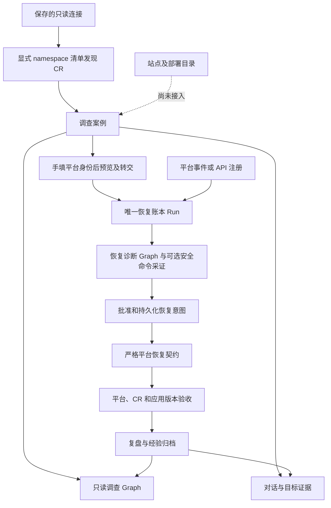

# 部署运维 Agent 业务闭环复审

> 当前进展见 [评审修复与剩余问题](代码评审修复与剩余问题-2026-11-13.md)：历史 R1–R8 已有修复与回归；仍有只读目录关联缺陷，主服务未更新，完整现场验收未完成。下文保留原阶段证据。

评审日期：2026-11-13。审查对象为当前工作区，不以尚不存在的 Git HEAD 为基线。主项目为 `D:/codes/deployment-ops-agent`，同时核对 `D:/codes/lh-tenant` 中尚未交付验收的严格 Agent 接口。保留 2026-11-12 的历史报告，本文件记录新增实现后的现状。

本轮没有改产品逻辑、运行中主服务、主库配置或真实集群；增加隔离复现程序和本报告，重跑 Agent 的完整构建与测试。下述问题仍未修复，不应把本轮评审写成全流程已经可用。

## 审查结论

已存在调查案例、会话来源冻结、多 namespace 范围、深度只读采证、恢复转交和自动复盘，但发现、平台发布、执行身份、应用版本及学习归属仍没有完全一致的契约。当前有 **3 项 P1、5 项 P2**；另有尚未实现的平台部署目录接入。



Graph 是真实存在的。只读调查与恢复 Graph 的权限不同；恢复副作用由持久化状态机驱动。这一分工可以保留，问题在跨入口身份、数据契约与操作可达性。

## R1 / P1：严格平台快照的集群身份没有被 Agent 校验

- 位置：`src/main/java/com/lanhao/ops/port/KubernetesDeploymentPort.java:304`。
- 关联：租户 `DeploymentAgentContractService.java:95` 已返回 `clusterApiUrl`；Agent 的 `assertIdentity()` 只核对发布版本、验收目录和目标完成标志，不读取平台集群字段。
- `DeploymentIdentity` 证明的是本地 Run 与本进程执行身份一致；`DeploymentCaseService.blocked()` 比较的是页面连接与本地执行身份。两者均不能证明平台任务指向同一集群。
- 隔离复现：保持 UID、namespace、版本及目录不变，将平台响应改为另一个 `clusterApiUrl`，注册及发现仍成功；完全删除该字段也成功。
- 影响：平台路由换址或配置错误不触发应有的来源拒绝，页面会把尚未证明的跨系统关联当成已核验。这不是已证明的真实跨集群写入。
- 修复要求：严格契约必须返回且核验规范化集群身份；注册、发现、观察、对账、重试及验证统一检查。平台应把该身份纳入快照令牌；网关别名需要显式可信映射，不能放宽为只比较 namespace/资源名。

## R2 / P1：把平台任务生命周期身份当作应用发布版本，页面默认值也与平台不兼容

- 位置：`src/main/resources/static/app.js:466`；`src/main/java/com/lanhao/ops/port/KubernetesDeploymentPort.java:268`。
- 租户新契约 `DeploymentAgentContractService.version():140` 返回 `provision-{taskId}-{requestSnapshot摘要}`。现有恢复消费者 `SiteProvisioningRecoveryService.java:398` 对开通发布使用 `site-{siteId}`，扩容则使用冻结的实际 releaseVersion。
- 页面转交表单却预填 CR 的 `releaseVersion`，直接作为 `expectedVersion`；新平台契约会拒绝此默认值。即便人工查出正确任务版本并完成转交，应用健康检查返回实际发布版本时，Agent 又会要求其等于 `provision-...`，从而始终验证不通过。
- 隔离复现：平台身份为 `provision-...`、健康响应为 `UP/site-6328132` 时验证为 false；把健康响应改成该任务身份才为 true。
- 修复要求：分别建模不可复用的部署生命周期身份和经过平台绑定的应用发布版本；在注册时持久化并在验收时校验实际发布版本。页面应查询受权平台快照，不能让用户猜测任务身份，也不能取消版本检查来绕过不一致。

## R3 / P1：没有执行过恢复的建议仍会自动成为 VERIFIED 经验

- 位置：`src/main/java/com/lanhao/ops/persistence/JdbcRunStore.java:136`；`src/main/java/com/lanhao/ops/memory/MemoryStore.java:118`。
- `RunEngine` 在 RETRY_WAIT 先扣意图预算，进入 EXECUTING；下一次如果现场已经自行健康，会直接进入 VERIFYING，并允许在 `recovery == null` 时完成成功验收。这是合理的停止重复操作路径。
- 但成功归档只要求 SUCCEEDED、attempts>0 和 plan 存在，不要求恢复受理凭据。于是原本未执行的建议和未经验证的根因被写为“执行动作”“已通过受控恢复验收”，状态自动为 VERIFIED。
- 隔离复现完整经过状态机：重试调用次数为 0，任务 SUCCEEDED，attempts=1，recovery=null；`MemoryStore.capture()` 仍产生 VERIFIED，且在相同来源可自动召回。
- 修复要求：区分意图次数、已受理动作、自然收敛与经过动作的恢复成功。自然收敛或无可信动作对账时只生成 DRAFT 复盘；可信受理结果及稳定验收均满足后，才可归档“有效恢复方法”。不能只补一段提示词。

## R4 / P2：多 namespace 成功经验无法由原调查案例召回

- 位置：`src/main/java/com/lanhao/ops/domain/DeploymentIdentity.java:47`；`src/main/java/com/lanhao/ops/console/ChatContextGuard.java:39`；`src/main/java/com/lanhao/ops/memory/MemoryStore.java:106`。
- Run 把所有 namespace 排序后用逗号拼成一个范围再 hash；发现调查和关联聊天使用单个实际 namespace 的 hash。FTS 查询又要求 scope_key 完全相等。
- 隔离 SQLite FTS5 复现：包含 common/prod 两个目标的已验证 Run 经验，在 Run 自己的组合范围命中 1 条；从同一案例的 common 范围查询命中 0 条。
- 影响：正好在多环境发布闭环中，经验已经保存却在下次排查时不可见。FTS 分词优化不能解决来源键不一致。
- 修复要求：建模明确的来源/适用范围关联，保证调查案例能引用其关联恢复经验；必须继续隔离其他集群及未经授权 namespace，不能简单删除 scope 过滤。多 namespace 经验也不能无条件向任意一个 namespace 全文公开。

## R5 / P2：通过平台事件或 API 创建的批准任务在页面上没有批准入口

- 位置：`src/main/resources/static/app.js:334`，对照 `:452`。
- 普通 Run 列表只有“详情”和“询问 Agent”；详情仅展示 JSON。批准与停止按钮仅存在于 `showDiscovery()` 的关联案例详情。
- 触发条件：`AGENT_AUTO_RETRY=false`，任务通过事件或 `/api/runs` 注册，且没有关联发现案例。进入 WAITING_APPROVAL 后，控制台用户没有可达按钮批准当前方案。
- 影响：后端批准 API 存在，但用户从正常页面无法把流程继续下去，最终等到截止转人工。
- 修复要求：普通任务详情同样提供当前计划的批准和允许状态下的停止，复用服务端 planId、租约及预算校验；所有 Run 入口拥有相同可达的操作能力。

## R6 / P2：辅助记忆存储故障阻断整个调查案例和恢复操作界面

- 位置：`src/main/java/com/lanhao/ops/console/DeploymentCaseService.java:56`。
- 案例详情同步调用 `memories.bySourceRefs()`，没有可降级的读取状态。前端在该接口整体成功后才渲染证据、恢复状态和批准按钮。
- 隔离复现：主案例与聊天查询正常，单独令 MemoryStore 读取失败，`view()` 直接抛异常。
- PostgreSQL 模式下记忆位于独立 SQLite 文件；该文件损坏/不可读取不应连带阻断主库内的调查与批准操作。SQLite 完整模式下主库本身故障则是另一种情形，不能声称仍能操作。
- 修复要求：可选总结读取失败返回明确的学习缺口，仍返回主事实和可执行操作；主库或身份校验失败仍必须阻断，不能统统吞异常。

## R7 / P2：平台七秒采证预算仍存在未受限的网关调用

- 位置：租户 `SiteProvisioningRecoveryService.java:285`；`ProjectProvisionService.java:1383`、`:1880`。
- `agentPlan()` 打开有共享预算的 ProvisioningResourceReader，但资源目录生成仍调用旧 `recoveryResources(project, release)`。历史 PostgreSQL 兼容分支进入 `existingReadyLegacyPostgres()`，使用原 `gatewayFor(project)` 读取 CR 和 Secret，没有使用该 reader。
- 原网关读取超时为 10 秒，并可能存在重试。预算只在调用返回后才能检查，无法兑现共享 7 秒的约束；恢复入口此时还持有任务及项目锁。
- 这是静态确认的可达分支；本轮未连真实网关做超时注入，不把任何耗时数字当作现场测量。
- 修复要求：目录与兼容读取都接受同一有界 reader，recover 前后两次采证共用一个预算；原业务路径及历史 PostgreSQL 所有权/就绪/凭据门禁必须保留。同时将预算超时映射为可区分的服务不可用响应，不能统一返回前提冲突。

## R8 / P2：诊断 Graph 与聊天绕行不同的 LLM 错误处理路径

- 位置：`src/main/java/com/lanhao/ops/console/RuntimeNarrator.java:28`；`src/main/java/com/lanhao/ops/diagnosis/AiNarrator.java:43`。
- 对话走 `ModelGateway.complete()`，保留本地安全分类、HTTP 状态及耗时；运行时诊断直接取 `gateway.model()`，再由 AiNarrator 调用 SDK。AiNarrator 吞掉所有运行异常，统一回退为“模型不可用，已回退规则手册”。
- 隔离复现：模型抛出已经安全分类的 429/RATE_LIMIT，诊断结果的来源仍只有通用回退信息，丢失限流类别。
- 影响：同一配置的“测试连接”“对话”“生成方案”表现不同，排查间歇 LLM 问题时无法从案例确认是超时、权限、限流还是响应结构问题。规则回退应保留，错误分类也应保留。
- 修复要求：统一底层模型调用与安全分类；结构化输出解析失败另行分类。保存必要的本地错误元数据及关联请求，禁止回显上游正文、密钥或原异常链，不自动增加重试次数。

## 尚未完成的接入范围

1. **站点 → 开通任务 → 项目 → 集群 → namespace → CR 映射仍缺失。** 目前新增的是显式多 namespace 清单，不会自动发现新站点。租户接口只有按 ID 查快照/恢复，没有 Agent 部署目录；平台也未自动向 Agent 发部署事件。
2. **CR 前置阶段仍不可完整观察。** 租户新 `snapshot()` 先要求平台项目已经存在；在项目创建前失败会返回前提冲突，而不是资源未创建的合法生命周期快照。原生 CR 发现自然也看不到尚未创建的资源。
3. **连接与恢复身份仍是两个运维配置。** 页面导入的是只读连接；真实执行还需独立平台凭据、明确 Kubernetes 身份、受权 namespace 和服务端验收目录。这是需要保留的权限边界，但当前缺少接入就绪检查与统一可读状态。
4. **严格后端当前只支持单集群任务。** 多 namespace 不代表多集群；两地开通不能宣称已覆盖。
5. **自我学习目前为规则模板复盘、人工确认及词法召回。** 尚无经验有效性反馈与修订闭环，不能描述成模型已经持续自行验证、学习和改进根因判断。

上述范围并非全部属于新回归，但都影响用户所需的完整 Agent；应与确认的代码缺陷分别验收。

## 本轮验证与边界

- Agent 全量 `mvn verify`：**210 项，0 失败、0 错误、0 跳过**。SQLite 使用隔离临时文件；PostgreSQL 显式使用本机专用 `127.0.0.1:55439/agent_test`。日志：`tmp/review-20261113/verify.log`。
- 额外隔离复现程序：`tmp/review-20261113/ReviewProbe.java`。仅本机 HTTP 替身、Mockito 和内存 SQLite；没有真实模型、集群或业务库调用。
- 原始断言结果：`tmp/review-20261113/results.json`。关键结果：

```json
{
  "wrongPlatformClusterAccepted": true,
  "missingPlatformClusterAccepted": true,
  "readyApplicationReleasePassesProvisioningVersionCheck": false,
  "fabricatedProvisioningVersionPasses": true,
  "spontaneousRecoveryState": "SUCCEEDED",
  "spontaneousRecoveryIntentCount": 1,
  "spontaneousRecoveryHasReceipt": false,
  "noActionExperienceStatus": "VERIFIED",
  "noActionExperienceIsAutoRecallable": true,
  "multiNamespaceRunMemoryHits": 1,
  "sameCaseNamespaceMemoryHits": 0,
  "memoryOutageBlocksCaseView": true
}
```

- R5、R7 为静态可达路径核对；R2 同时核对两个项目的真实版本构造代码及前端默认值，动态探针验证消费者行为，尚未运行新的租户后端端到端测试。
- 租户新增严格接口此前只有六模块 compile 通过，本轮没有将其算作完整契约验收；尚无本轮实际浏览器操作或真实恢复验收。
- 既有测试主要分别验证消费者/生产者假定的字段或 mock 掉 DeploymentPort，因此全部通过与这些问题存在并不矛盾。后续应增加同一发布身份从平台真实快照序列化到 Agent 消费的跨仓契约测试。

## 修复与验收顺序

1. 先修 R1/R2/R3：集群来源、两类版本与学习可信度。为每个复现增加失败在前、修复后通过的回归测试。
2. 打通受权部署目录与前置阶段，停止让用户手抄发布身份；完成后端实际 PostgreSQL 契约验证及原恢复消费者回归。
3. 补 R4/R5/R6：同案例经验引用、所有入口可达的批准操作、辅助存储降级。
4. 补 R7/R8：统一有界采证及可观测模型调用，保留安全边界和规则回退。
5. 第一轮优化以隔离跨系统完整恢复演练为依据；第二轮以失败/超时/自然收敛/下次经验召回演练为依据，分别记录改动和验证。真实集群写入另按明确目标授权验收，不以本机替身冒充。

`PITFALL_RECORD_DECISION`：暂缓。当前为已复现或静态确认但尚未修复的问题，不应提前归档为已解决坑。`PRD_SYNC_DECISION`：无需变更功能 PRD；本轮仅评审和隔离验证，没有修改产品有效逻辑，交付状态同步至计划文档。
