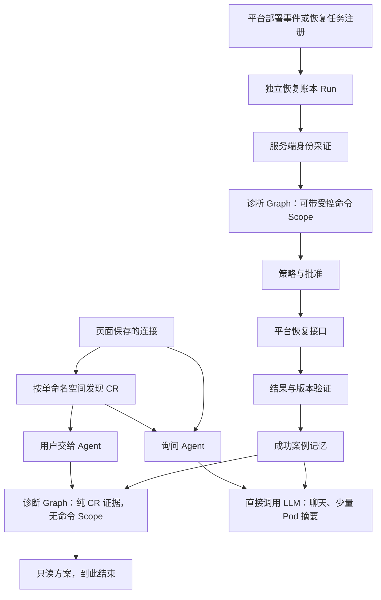

# 部署运维 Agent 链路代码评审

评审日期：2026-11-12。范围：独立项目 `D:/codes/deployment-ops-agent`，并只读核对当前 `lh-tenant` 和 `webapp-operator` 源码中的关联契约。

本次没有修改产品代码、现有配置、真实集群或租户数据库。执行了两项本机 HTTP 复现，使用全新 SQLite 文件、独立密钥、规则助手和模拟 Pod API；未调用真实模型。复现所用 Jar 为当前 `target/deployment-ops-agent-0.1.0-SNAPSHOT.jar`（2026-11-12 18:22:50 构建）。本次没有重跑全量 Maven 测试；既有测试通过不能作为本次业务闭环验收证据。

## 总体判断

目前具备多个独立能力，但缺少统一部署案例与跨入口的身份映射、证据共享和授权转交。主要问题有两类：一是上下文身份绑定存在实际缺陷；二是现行 PRD 刻意保留的只读边界、单命名空间范围和平台待接入项，尚不足以满足最初“监控—诊断—排障—重试—验证—记忆”的完整目标。安全边界需要保留，但应提供有身份核验的转交路径。



Graph 确实存在，但负责诊断及可选命令采证；恢复状态由 `RunEngine` 持久化推进。这个分工本身可以成立。断点在于发现、聊天与恢复没有统一的业务案例关联，也没有受控转交入口；单纯扩大 Graph 或增加按钮不会自动补全这些关系。

## 发现与建议

### F1 / P1 / 已复现缺陷：允许关联互不匹配的恢复任务与集群连接

- 位置：`src/main/java/com/lanhao/ops/console/ConsoleController.java:64`；`AgentChat.java:93`；`AgentChat.java:125`。
- 创建普通会话仅验证 `connectionId` 和 `runId` 各自存在，没有验证二者的环境、集群、命名空间和目标归属。发现任务分支有额外一致性检查，普通恢复任务分支没有。
- 随后 `AgentChat.context()` 将该连接的实时 Pod 与该 Run 的故障和方案放入同一上下文；Run 部分也没有提供足够的集群、目标身份供模型核对。
- 本机复现：`agent-demo` 的 DEMO Run 与 `review-b` 的连接组合创建会话返回 HTTP 200，同轮规则回复同时包含 DEMO 故障证据及 `review-b-pod`。模型模式复用相同上下文构建逻辑，因此也会收到混合材料。
- 影响：即使用户只在页面选择已有选项，也能形成错误关联。此处不是已证明的跨集群写入，但会污染诊断和后续人工操作判断。
- 建议：由服务端把 Run 映射至可核验的集群和目标；关联时核对环境及目标集合。无法证明匹配时拒绝附加实时快照，提示创建正确案例；不能依赖提示词自行判断。

### F2 / P1 / 已复现缺陷：普通历史会话会跟随连接编辑静默更换目标

- 位置：`src/main/java/com/lanhao/ops/console/ChatStore.java:15`；`ConsoleSettings.java:97`；`AgentChat.java:119`。
- 会话只保存连接 UUID。普通会话每轮读取最新连接；仅 `discoveryId` 会话核对发现时的目标摘要。
- 本机复现：同一会话第一次读取 `review-a-pod`；将同 ID 连接的 namespace 改为 `review-b` 后，再发一轮就读取 `review-b-pod`，没有拒绝或要求新会话。旧轮次仍保留并可作为模型历史。
- 更改 API 地址也有同类静态路径；凭据重输约束防止旧密钥被带到新地址，但不冻结会话目标。本次动态复现只覆盖 namespace 修改。
- 影响：页面显示会话上下文固定，但历史分析和本轮采集已经属于不同环境。
- 建议：会话持久化目标身份快照并在每轮采集前核对；API / namespace 更改后要求新建会话。名称修改及同目标凭据轮换可以继续，不宜只用 revision 一刀切拒绝所有更新。

### F3 / P1 / 跨系统接入缺口：默认严格恢复契约与现有租户后端不匹配

- Agent 位置：`src/main/java/com/lanhao/ops/port/KubernetesDeploymentPort.java:303`、`:230`；默认开关 `src/main/resources/application.yml:79` 的 `strict-platform-contract` 配置。
- Agent 严格模式要求 `version`、`verificationProfile`、布尔型 `targetsComplete`、`targets` 以及观察时的 `snapshotToken`；恢复调用 `POST /provisioning-instances/{id}/agent-recoveries`。
- 当前租户源码：`D:/codes/lh-tenant/lh-tenant-client/src/main/java/com/lh/tenant/client/kubesphere/dto/KubeSphereDTOs.java:119` 的 Provisioning 返回 `targetVersion` 等字段，没有上述目标快照契约；`lh-tenant-adapter/src/main/java/com/lh/tenant/adapter/kubesphere/web/KubeSphereIntegrationController.java:156` 提供 `/retry`，没有上述严格恢复接口。已对当前主源码目录检索核对，未核验另有独立部署版本或外部适配器的情况。
- 影响：即使补齐服务端启动配置与平台注册入口，严格模式仍会在注册/身份检查阶段失败；页面连接测试成功不能证明平台恢复可用。
- 当前文档已承认“平台扩展待对接”，因此这是接入阻断项，不是声称平台已有功能发生回归。
- 建议：联合实现版本化目标快照、原子恢复受理和动作对账，并建立跨仓契约测试。不能把关闭严格校验作为完成自动恢复的替代方案；现有兼容路径还要求关闭自动恢复，且需要单独验收。

### F4 / P1 / 产品闭环缺口：发现和聊天没有通往受控命令与恢复的路径

- 位置：`src/main/java/com/lanhao/ops/console/DiscoveryService.java:29`；`diagnosis/DiagnosisGraph.java:75`；`command/KubectlWorkflow.java:22`；`console/AgentChat.java:48`、`:68`。
- “交给 Agent”只重新读取 CR、调用 `diagnose(Evidence)`、保存 `automatic=false` 方案。该重载传入 null Scope；即使开启 kubectl，命令生成阶段也直接跳过。不会创建或关联 Run。
- 对话直接调用模型，不走诊断 Graph，也没有工具执行能力。平台部署事件和 `/api/runs` 是另一条独立入口，页面没有从发现记录转交的机制。
- 这符合当前《部署发现与手动接管 PRD》第 14–16、57 行的明确限制，却不等于最初完整运维目标已经交付。
- 建议：引入统一部署案例，先提供身份固定的只读调查及证据共享；用户再显式申请受控恢复，由服务端获取并核验平台注册快照、独立执行身份、批准和预算，关联唯一 Run。不要直接拿页面只读连接替代恢复授权。

### F5 / P2 / 监控范围缺口：集群连接等同于一个 namespace，无法覆盖站点部署周期

- 位置：`src/main/java/com/lanhao/ops/console/DiscoveryGateway.java:50`；`ConsoleSettings.java:25`。
- 扫描路径固定为连接里的单个 namespace；没有站点 → 项目 → 环境 → namespace → CR 的映射，没有聚合同一次发布的多个 CR。
- 影响：连接本身正常但部署创建在其他 namespace 时完全不出现在清单；修改连接 namespace 只会切换监控范围，并让旧发现目标失效，无法同时覆盖新旧站点。CR 创建前的平台前置失败也不在这条发现链路中。
- 当前 PRD 明确声明此限制，属于覆盖范围不足。
- 建议：分离集群连接、受权监控范围和部署案例；从受权平台接口同步站点部署清单，使用显式 namespace 清单或受控范围发现。按集群、项目、环境和发布版本聚合资源，避免默认全局扩权。

### F6 / P2 / 诊断证据缺口：用户常用入口拿不到已经实现的深度采证

- 位置：`src/main/java/com/lanhao/ops/console/DiscoveryGateway.java:21`；`KubeSphereGateway.java:33`；对照 `port/KubernetesDeploymentPort.java:133`。
- 发现方案只有单条 CR 摘要。聊天最多读取 namespace 列表返回的前 10 个 Pod，只有 name / phase / ready；未跟随 continue、未按所选目标归属过滤，也未提供容器错误、重启、Events 或日志。接口说明了“最多 10 个”，但无法证明它们覆盖正在排查的应用。
- 恢复 Port 已有有界的容器状态、日志和事件采集；发现与聊天入口无法复用它。其 ownerReference 方案还需针对 Helm 管理资源单独核验，不能直接视为所有工作负载均已覆盖。本次查看到 RabbitMQ Helm 安装 Job 确实设置了 Runtime ownerReference，因此不认定该 Job 必然被过滤。
- 影响：CR 只说“组件等待”时，Agent 缺少进一步判断调度、镜像、存储、Job 等根因的材料；同 namespace 多应用还可能看到无关 Pod。
- 建议：抽取独立的目标采证服务，输入冻结身份、受权只读连接和资源映射，输出统一证据包及明确采集缺口。优先异常目标，保留请求/字节/时间预算，三个入口共享证据引用。

### F7 / P2 / 记忆可信度缺口：来源范围只有进程模式，不能区分实际调查环境

- 位置：`src/main/java/com/lanhao/ops/memory/MemoryStore.java:43`、`:84`；`memory/MemoryRecall.java:15`；`console/AgentChat.java:40`。
- 记忆环境取全局 `config.mode()`；搜索只有该环境和状态过滤。真实 KubeSphere 只读连接可以在 DEMO 模式下使用，聊天保存的思路仍被归到 DEMO；同模式下的其他集群、项目经验也会参与自动召回。
- 影响：进程运行模式不能准确代表某次证据来源，模拟验证经验可能被送入真实集群对话；当前提示词会声明“仅供参考”，但存储层没有可筛选的实际来源边界。
- 现行记忆 PRD 明确没有连接/集群/租户隔离，因此不能声称发现了多租户权限绕过。本次对此做静态核对，没有调用真实模型验证回答偏差。
- 建议：记忆增加来源环境、集群、项目/namespace、应用版本、证据与验证结果引用。真实调查默认排除模拟案例，允许明确标记的跨环境通用经验；FTS5 继续负责文本检索，不能替代来源过滤。

## 复现证据

脚本：`tmp/review_chain_repro.py`。一次运行同时复现 F1、F2；所有地址均为回环本机，进程结束后已停止隔离服务和替身。脚本会创建新的临时数据库，不清空主库。

本轮结果：`tmp/review-chain-3b827f8f.json`；隔离启动日志：`tmp/review-chain-3b827f8f.log`。临时目录不作为长期文档依赖，关键断言记录如下：

```json
{
  "mode": "DEMO",
  "realServicesCalled": false,
  "targetDrift": {
    "beforeContainsNamespaceA": true,
    "afterContainsNamespaceB": true
  },
  "mixedTarget": {
    "sessionHttpStatus": 200,
    "runNamespace": "agent-demo",
    "connectionNamespace": "review-b",
    "answerContainsFixturePods": true,
    "answerContainsDemoEvidence": true
  }
}
```

其他条目为静态代码与 PRD/契约核对，未把假集群或规则助手结果算作真实部署恢复验收。

## 为什么现有测试未阻止这些断点

`src/test/java/com/lanhao/ops/console/DiscoveryContract.java:132` 的契约测试明确断言：接管生成只读方案、没有命令执行、没有新增 Run。这有助于验证安全边界，但证明的是子系统隔离。它不验证用户需要的受控转交闭环。F1/F2 的跨目标一致性场景也没有被这些断言覆盖。

建议新增有业务目标的跨入口验收，而非仅验证调用次数：

1. 不同集群/namespace 或模拟/真实身份的关联必须被拒绝；普通会话目标编辑后不可静默漂移，同目标凭据轮换仍可继续。
2. 平台站点部署从前置阶段到 CR 出现、新代次、缺失和终态，始终关联同一发布案例，重放不增加恢复预算。
3. 用户选择只读调查后，证据、命令审计、方案和后续对话共享目标身份与采证时间；没有执行授权时不产生写动作。
4. 显式受控恢复转交成功后，平台与 Agent 对版本、UID、快照和幂等键达成一致，验证成功才记录已解决案例；未知执行结果先对账。
5. DEMO 与真实调查的自动记忆召回可证明隔离；LLM 失败保留可检索的错误分类及关联请求，手册回退不显示成真实恢复成功。

## 建议实施顺序

1. 先修 F1/F2 的目标一致性，避免继续积累混合证据与记忆。
2. 定义部署案例和集群/监控范围/发布身份，联调 F3 的平台契约，再接 F4 的显式转交。
3. 抽取统一只读采证并补齐站点部署监控范围，关联命令、方案、对话及恢复账本。
4. 增加记忆来源和跨入口验收后，再扩展自动恢复动作。

本报告是评审结果，不表示上述建议已经实施，也不修改现行 PRD 来掩盖实现差距。
