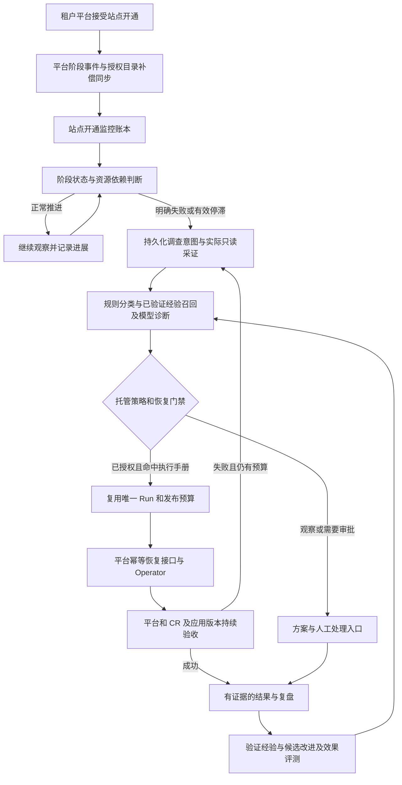

# 站点开通部署自愈与持续学习迭代方案

日期：2026-11-13。状态：方案 v1；Agent 首期实现进展见[实施与验证记录](站点开通首期_实施与验证记录.md)。

实施说明：P1 / P2 的 Agent 侧首版及结果统计已落地，平台生产端、P0 真实接入恢复、新动作和候选知识评测仍有待办。下文保留原方案设计；第 8 节测试数字属于方案编写时的历史记录，当前结果以实施记录为准。

本方案基于当前工作区代码、项目 PRD 和已知问题编写，包含尚未提交的实现。它定义后续迭代，不代表这些能力已经上线；本轮不执行真实集群恢复，也不修改平台或 Operator。

## 1. 目标与结论

目标是：租户平台发起站点开通后，Agent 自动跟踪平台阶段及 KubeSphere 对应 Kubernetes 资源；出现失败或停滞时自动采证、诊断，在授权范围内执行已验证的恢复方案，验证结果，沉淀可追溯经验，让后续相同问题更快定位和恢复。

建议保留现有 Java / Spring AI Alibaba Graph、持久化状态机和平台恢复接口，在其上补齐五件事：

1. **以站点的一次开通为主线。** 从平台接受开通请求开始跟踪，覆盖 CR 尚未创建的阶段，将同次发布的多个资源聚合起来。
2. **将手动接管升级为按策略托管。** 一次配置明确范围及自动化等级，后续新开通任务自动进入监控，异常才触发模型。
3. **先兑现现有重试能力，再增加恢复手册。** 当前只有一个自动动作，无法覆盖所有部署故障；新增动作需要平台及 Operator 的真实契约支撑。
4. **让结果决定经验可信度。** 验证成功、自然收敛、失败和人工修复分别记录，避免把模型建议当成有效修复。
5. **让改进经过评测再上线。** 自动整理候选经验、统计有效性、评测新版本；执行器、权限、预算和新的动作类型经工程评审发布。

第一阶段可交付的产品承诺是“自动监控、自动排查、已授权低风险故障自动恢复、其余问题提供证据和处理建议”。所有故障均自主修复不作为首版承诺。

## 2. 现有实现与差距

| 能力 | 代码事实 | 与目标的差距 |
| --- | --- | --- |
| 平台站点目录 | `PlatformCatalog` 每 30 秒同步；目录包含 siteId、任务版本、currentStep、项目与集群映射；`monitor()` 可将明确 namespace 纳入发现 | 同步的是目录快照，缺少站点阶段历史、阶段停滞判断和自动托管决策；关联项目仍是人工操作 |
| 集群资源发现 | `DiscoveryScheduler`、`DiscoveryStore` 按连接的 1–20 个明确 namespace 扫描四类 CR，按 UID/generation 去重 | 新记录进入 PENDING；`select()` 后才入调查队列，不会默认自动诊断或恢复 |
| 平台事件 | `OperationsController` 提供 `/api/deployment-events`；`DeploymentInbox` 幂等创建或复用 Run | 已有接收端；当前仓库不能证明租户平台已持续投递。现有事件只有 eventId、provisioningId、deploymentVersion、verificationProfile，不能充当完整阶段事件流 |
| 无 CR 阶段 | `RunEngine.DISCOVERING` 等平台完整目标；`KubernetesDeploymentPort.discover()` 前置失败时停止，等待超时转人工 | 可有限等待，无法完整诊断项目创建、平台编排等前置阻塞；只读目录和严格恢复快照必须继续分开 |
| 阻塞诊断 | `RunEngine.monitor()` 根据明确失败或进展指纹停滞触发；默认停滞阈值 10 分钟。`DiagnosisGraph` 做规则分类、记忆召回、可选受控命令采证及模型分析 | 缺少按业务阶段定义的进展、依赖关系及差异化超时；扫描失败与实际部署失败需要在站点视图中分别呈现 |
| 只读调查 | `ReadOnlyEvidenceCollector`、`ChatInspectionGraph` 读取归属资源、异常容器、事件及有界日志，持久化请求审计 | 无 CR 所有权链的 Helm 中间件资源仍有覆盖缺口；现场事件/日志权限也有缺口，不能凭失败 Job 退出码确认根因 |
| 自动恢复 | `RecoveryPolicy` 仅将有当前决定性证据的部分网络超时、DNS 暂时失败、HTTP 429/503/504 分类为 RETRY_TRANSIENT；缺失证据或高风险迹象转人工 | `Model.Action` 只有 RETRY_TRANSIENT / MANUAL_REPAIR；`RunbookRegistry` 只有 `platform-transient-retry` v1。重启、配置修复、容量调整、回滚等都不是现有自动能力 |
| 执行及验收 | `RunEngine` 先持久化动作身份和预算，再调用平台；对账复用原动作键；验证 CR、平台、恢复身份和应用版本，默认连续 3 次 | 核心机制可复用；真实平台身份、验收档案及现场恢复尚待验收。自动化开关目前主要是进程级 `autoRetry` |
| 沉淀与召回 | `LearningOutbox` 生成 DRAFT；满足受理和恢复验证条件的 RUN 自动归档 VERIFIED；`MemoryRecall` 同范围 FTS5 最多召回 3 条；已有 revision、反馈和过期降级 | 已具备初步学习闭环；缺少结构化故障适用条件、动作效果统计、故障回放评测和候选手册发布流程 |
| 规模与隔离 | Run 具备租约和身份冻结；当前执行适配器使用固定集群身份，诊断 Graph 用锁隔离调用；SQLite 为单实例 | 多只读连接不等于多集群恢复。扩大并发前需要独立 Graph 调用状态、队列公平性和容量验证 |

**现场状态按最新记录理解，不从旧报告推断上线。** [已知问题](../ai-shared/memory/known-issues.md)记录：8100 仍运行 243 项验证对应旧包；后续对话采证实现有 258 项 Maven 和 6 项 UI 的历史验证记录，但主进程更新未完成。目录曾取得真实列表和单条映射结果，但 Agent 目录仍关闭；恢复仍为 DEMO，独立执行身份及双方验收档案未配置，事件/日志出现过 403。本轮未复测在线状态，上述历史数字不作为本轮测试结果。

## 3. 产品流程与身份模型

职责分工：租户平台提供站点、项目、发布周期、阶段及恢复契约；KubeSphere/Kubernetes 提供现场事实；Operator 执行已有部署编排；Agent 负责监控、调查、策略、调用、验收和复盘。模型不接管 Kubernetes 写权限。

建议新增 `ProvisioningWatch` 作为业务聚合，关联多个调查案例和一个发布周期的恢复账本；不要把现有按 CR 保存的调查记录直接当成一个完整站点。

身份链建议为：

`平台实例 + 授权租户/工作空间 → siteId → provisioningId + deploymentVersion → clusterApi + namespace → CR UID + generation`

- `deploymentVersion` 标识部署生命周期，`applicationVersion` 标识实际应用版本，继续分别冻结和校验。
- 业务幂等身份使用稳定平台实例 ID，不使用会随 Token 轮换变化的目录缓存来源键；Token 轮换仍须重新验证授权。
- `ProvisioningWatch` 可在项目、namespace 和 CR 尚未创建时存在；只有受权平台响应证明的映射才允许补入，不根据名称猜测。
- 平台目录只能说明观察范围，不能授予执行权限。进入恢复前重新读取严格快照，校验完整目标、同集群执行身份和验收档案。
- 托管范围必须落在已授权的平台数据范围和明确 namespace 清单内。新 namespace 未列入时显示“待纳管”，不自动扩大现有 1–20 个 namespace 限制。
- 首期每个执行实例负责一个集群；需要跨集群站点时由聚合视图关联各自 Run，不能共用一个客户端身份执行。
- 原终态或新调查案例不重置同次发布预算。正式变更产生新发布周期后才使用新身份，不能用新 requestId 伪造新周期。

## 4. 迭代安排

估算前提：一名熟悉项目的后端开发，平台侧有人配合契约及测试，运维提供授权非生产目标。以下为工程工作量区间，现场等待不计入；不是承诺工期。

| 迭代 | 目标 | 主要交付 | 建议工作量 | 出口条件 |
| --- | --- | --- | --- | --- |
| P0 现场基线 | 兑现已有能力 | 版本核对、目录实接、只读权限补齐、执行身份与验收档案、一次受控恢复演练 | 2–4 人日 | 能区分目录/只读/恢复就绪；有真实恢复受理与验收证据 |
| P1 开通全程监控 | 不依赖人工找 CR | 平台阶段契约、事件与补偿同步、站点监控账本、阶段时间线及停滞判断 | 5–8 人日 | 新开通自动可见；无 CR 失败能定位阶段；重放乱序不重复建单 |
| P2 自动托管 | 低风险故障形成自动闭环 | 分范围策略、异常自动调查、自动转交唯一 Run、限流熔断、完整产品操作 | 5–8 人日 | 白名单站点无需逐单点击即可完成现有低风险恢复，危险及缺证场景零下发 |
| P3 恢复能力扩展 | 从单一重试扩大覆盖 | 高频故障统计、版本化手册协议、首批 1–2 个新动作及平台实现 | 8–12 人日 | 每个新动作独立通过契约、故障注入、审批灰度和验收 |
| P4 持续改进 | 用真实结果证明越用越好 | 结构化经验、适用条件、效果统计、回放评测、候选版本和回退 | 5–8 人日 | 相同评测集新版本有可解释改善，越权与错误自愈无回归，可回退 |

推荐先交付 **P0 + P1 + P2**，预计 12–20 人日；这是“站点自动监控 + 已有低风险恢复”的最小产品。P3、P4 在取得现场故障样本后继续，避免脱离真实问题批量堆执行动作。全方案约 25–40 人日，平台侧大幅改造或多集群执行另行估算。

### P0：先建立真实环境基线

1. 对齐运行 Jar、当前构建、数据库迁移和页面能力；更新前配套备份数据库与主密钥，不覆盖已有配置。
2. 实测目录同步、站点映射和只读采证。按明确 namespace 核验四类 CR、工作负载、Pod、events、pods/log 的必要 get/list 权限；由运维补充最小权限，不由 Agent 自动改 RBAC。
3. 为明确目标配置独立恢复身份、HTTPS 平台恢复地址和双方验收档案；只读连接不充当恢复凭据。
4. 使用一条明确授权的非生产发布，先走人工批准，再验证固定动作键、平台受理、三次稳定验收、原范围经验召回。
5. 真实 RabbitMQ 案例可作为诊断样本，先补失败 Job 日志；只有取得决定性证据才决定是否有对应恢复动作，不能预设“重试必好”。

P0 不新增恢复类型。真实环境条件不满足时，后续编码与隔离测试可以推进，但不能打开真实自动恢复。

### P1：从 CR 发现升级为站点开通全程监控

**平台契约。** 在现有目录上新增或版本化提供阶段观察数据：任务身份、事件序号、阶段码、阶段状态、开始时间、最后有效进展时间、错误码、脱敏摘要、依赖阶段、目标映射状态及资源集合。字段名和阶段码需以平台真实业务流校准。

建议阶段展示为“开通受理 → 项目准备 → 数据库/基础组件 → 运行环境 → 应用发布 → 站点验收”。这是待映射的业务视图，不能硬编码四种 CR 一定严格串行；依赖图由平台阶段语义与实际资源关系决定。

**事件与补偿。** 平台业务状态更新与出队事件同事务提交；Agent 保存收件箱并返回回执。事件投递失败采用有界退避，授权目录定期补偿。补偿同步使用增量游标与稳定排序，游标过期时支持有界重新扫描；部分分页结果不能当成全量删除或任务终止。

现有 `/api/deployment-events` 是“启动监控”的协议，同一 provisioningId/deploymentVersion 合并到一个事件身份。阶段流应采用独立版本化协议与事件表，按 `平台实例 + eventId` 去重、按任务 revision/sequence 接受更新，不把多条阶段变化强塞入现有单事件约束。

**进展判定。** 保存 `phaseStartedAt`、`lastMeaningfulProgressAt`、`lastObservedAt`。只有阶段转换、受控子步骤完成、目标就绪数量等业务变化才算有效进展；轮询时间、日志新增和心跳不能无限延长截止时间。明确失败立即进入异常判断；阶段停滞阈值、总时限和失败确认策略按版本配置，先用 10 分钟作为缺省回退，再根据现场耗时调整。

**无 CR 场景。** 只读阶段接口允许返回“项目尚未创建”，提供平台错误码和前置步骤证据。该场景创建平台调查，首版可自动定位并转人工；不跳过严格恢复快照的目标完整性门禁。

**非故障分类。** 网络不可达、403、目录过期分别进入“观察降级/证据不足”，不当作业务部署失败。健康部署不调用模型。上游依赖阻塞时聚合成一个站点事件，避免每个下游 CR 分别报警。

### P2：按策略自动接管，复用既有恢复链路

新增版本化 `AutonomyPolicy`，按稳定平台身份、项目/站点、连接与明确 namespace 绑定，不仅使用进程级 `AGENT_AUTO_RETRY`。

| 策略 | 行为 |
| --- | --- |
| OBSERVE | 自动监控，展示阶段和异常；不自动调用模型 |
| DIAGNOSE | 异常时自动采证、分析及生成方案；不自动创建恢复动作 |
| APPROVAL | 自动完成调查和严格恢复预检，进入待批准；批准当前 planId 才执行 |
| AUTO_LOW_RISK | 在明确授权范围内，命中已发布低风险手册且满足全部门禁时自动执行 |

默认沿用现有手动行为；只有显式启用的范围进入自动托管。生效权限取进程允许范围、平台授权、连接冻结范围、托管策略与手册允许能力的交集。策略版本、操作者、触发原因、证据摘要和所选手册版本都进入审计。

具体实现要求：

- 增加自动接管调度器，复用调查服务和案例转交校验；不要模拟控制台点击，也不要另写绕过校验的恢复入口。
- 将手动与自动转交共用的“核验 → 查找同发布 Run → 创建或复用 → 关联案例”提炼为应用服务；事务和唯一约束防止事件、目录、人工同时创建两套预算。
- 以业务发布、故障指纹、证据修订建立诊断触发记录；同一故障不会每 30 秒重复调模型。部署恢复失败且出现新证据时可以再诊断，仍受发布级诊断次数、恢复次数和总时限限制。
- 模型超时、连接中断或执行状态未知不能自动重放原模型调用。保存失败结果并规则回退或转人工；新调用必须由新的有效证据/明确人工请求触发并记账。
- 当前恢复意图预算仍默认 2 次、配置上限 3 次；所有案例、手动重试及自动转交共享。平台已有 Operator 失败预算不能被 Agent 重置。
- 增加项目/集群并发配额、排队上限、冷却时间及熔断。首版建议一个项目最多一个恢复动作；集群允许并发从 1 起步。
- 策略关闭、暂停或紧急停止后，停止新的外部副作用；已经受理的动作继续只读对账并报告，不宣称已经撤销。未知结果必须先按原动作键对账。
- 不能直接移除 `DiagnosisGraph` 当前调用锁来提升吞吐。先统计队列延迟；确需并发时采用调用独立状态并通过跨调用/并发身份隔离测试，再调整容量。

诊断输出补充结构化“候选原因、支持证据、反对证据、缺失证据、建议动作、验证条件”。需要继续排查时，在原 Graph 的规则分类和安全检查边界内增加“缺口判断 → 白名单补采 → 重新分析”，首版最多 2 轮且共享调查总预算；模型置信度不作为自动动作授权依据。403、未知归属或预算耗尽停止补采，不能循环执行相同查询寻找想要的结论。

### P3：增加可验证的恢复手册

先用现场失败分布选择动作。`RunbookRegistry` 扩展为版本化、封闭执行目录，包含故障码、适用组件/版本、参数模式、目标选择约束、风险、授权方式、前置条件、执行接口、幂等规则、超时、验收、失败处置与禁用条件。

`RunEngine.safeToRetry()`、`Model.Action`、`Run.verifiedRecovery()` 当前都围绕 RETRY_TRANSIENT 编写。新增动作时应同步改为已注册执行器与通用可信受理/验收证据，而不是仅给注册表加一项就宣称支持。新动作不能通过任意字符串或模型参数变成可执行操作。

| 故障场景 | 首期决策 | 后续扩展条件 |
| --- | --- | --- |
| 明确暂时性网络/DNS/上游限流 | 复用现有平台暂时故障重试 | 继续要求当前决定性证据、证据完整、预算有效 |
| 平台步骤受暂时性依赖影响而中断 | 自动定位；现有契约覆盖不了则人工处理 | 平台新增明确步骤恢复能力、幂等回执和进度验收，先审批后灰度 |
| 已确认无数据副作用的幂等 Job 失败 | 默认人工批准候选 | 平台/Operator 提供合法的重跑语义；证明任务无数据迁移等副作用，禁止 Agent 直接删 Job 绕预算 |
| 无状态工作负载异常，需要受控重启 | 默认人工批准候选 | 平台支持版本冻结、可用副本/PDB 检查、稳定验收；不自动纳入“低风险” |
| 镜像不存在、配置错误、凭据失效 | 输出定位及受审变更建议 | 经正常配置/发布流程形成新版本后重新监控；不能用旧发布预算盲重试 |
| OOM、容量、存储、迁移、数据损坏 | 转人工，给出证据和步骤 | 扩容、资源变更、PVC/数据库操作及回滚单独设计，不纳入本轮全自动范围 |
| 只有 BackoffLimitExceeded/exitCode=1 | 继续采证，缺证则人工 | 取得错误日志及依赖状态后再分类，不能将通用症状直接绑定某个修复 |

无 CR 所有权链的 Helm 资源，可后续通过平台返回的受权资源目录扩展采证，必须绑定发布、namespace、资源 UID 和归属证明；不能仅凭名称前缀或 label 广泛抓日志。组件协议探测采用预注册的只读能力，执行身份、网络范围、审计和预算单独定义。

### P4：经验沉淀、评测与受控进化

保留现有 DRAFT / VERIFIED / 归档与反馈机制，补充结构化字段：组件及版本、平台阶段、错误码、症状指纹、证据引用、根因可信状态、适用条件、反例、实际执行的手册版本、受理凭据、前后状态、验收依据、耗时及复发情况。

区分三种结论：

- **方案有效**：有可信动作受理和完整稳定验收，能够形成已验证恢复经验。
- **根因确认**：有独立证据支撑，不能因为重试成功就断言模型猜测的根因正确。
- **人工修复有效**：关联真实变更记录和验收依据，由人工核验后成为 VERIFIED，不将聊天描述直接确证。

学习流程：

1. 对同来源案例自动归类，生成合并/补充候选；保留原始来源、人工编辑及归档状态，不自动覆盖现有经验。
2. 召回前先过滤来源权限、环境、组件/版本和适用条件，再进行 FTS5 排序；语义检索在词法召回评测不足后再引入，不作为首期前置依赖。
3. 保留最多 3 条的上下文预算，记录实际采用的经验 revision 和手册版本；失败、无效和复发同样进入效果统计。
4. 基于脱敏历史轨迹构建固定回放集，覆盖成功、失败、缺证、自然恢复、过期经验及提示注入；按发布周期隔离经验构建集与评测保留集，避免把同一案例答案泄漏到评测输入。评测环境不连接真实恢复执行器。
5. 新提示词、检索排序和候选手册先影子运行，与当前版本比较；通过评测及人工发布后才进入灰度范围。能力与权限边界变化必须代码评审并发布执行器。
6. 出现效果下降、错误作用域或错误执行时停止候选版本，恢复上一个批准版本；不通过回退知识版本重放外部动作。

自动化能持续完成采集、复盘、候选生成、评测和统计；知识可信升级沿用严格证据门禁。模型不能自行授权新动作、自增预算或改写自身生产代码。未来如要自动生成修复代码，可生成独立待评审变更，仍不自动合并或部署。

## 5. 数据、接口与代码落点

以下名称为建议，不是已存在的实现。主库迁移必须同时覆盖 PostgreSQL 和 SQLite；经验内容及检索仍沿用 SQLite FTS5。

| 新增/扩展对象 | 关键数据及约束 | 主要改动位置 |
| --- | --- | --- |
| `agent_provisioning_watch` | 稳定平台身份、授权范围、站点、发布周期、阶段、进展时间、映射完整度、策略版本、关联 Run；业务唯一键 | 新增站点监控服务，衔接 `PlatformCatalog`、`DeploymentInbox`、`DeploymentCaseService` |
| `agent_provisioning_event` | eventId、schemaVersion、任务序号、脱敏 payload、处理结果；重放幂等、乱序拒绝 | 独立阶段事件控制器/收件箱；现有启动事件兼容保留 |
| `agent_phase_observation` | 有界阶段历史、业务进展、来源时间与本地接收时间、证据缺口 | 新增阶段观察器；不把每轮日志全文存入时间线 |
| `agent_autonomy_policy` | 明确作用域、模式、允许手册版本、预算、冷却、并发、revision、启停及审计 | 新增策略服务；Graph 与 RunEngine 执行前复核 |
| `agent_diagnosis_trigger` | 任务、故障指纹、证据版本、触发原因、模型请求结果及预算 | 对接 `DiscoveryStore` 队列和诊断 Graph，防止无界重复调查 |
| `agent_recovery_outcome` | Run、actionKey、手册/知识/策略版本、受理及验收、自然收敛标记 | 衔接 `RunEngine`、`JdbcRunStore`、`LearningOutbox`，随状态保存出队 |
| 经验适用性及评测记录 | scope、组件版本、故障类型、样本来源、评测配置、指标及发布版本 | 扩展 `MemoryStore` / `MemoryRecall`，新增评测与候选版本服务 |

建议控制台提供“站点开通任务、托管策略、异常处理、经验效果”四个视图；仍可进入原始 CR 调查、对话和 Run。一个站点详情集中展示阶段耗时、阻塞依赖、已采集/缺失证据、正在执行的动作、剩余预算、验收结果与经验来源。

新增接口可按 `/api/console/provisioning-watches`、`/api/console/autonomy-policies`、`/api/console/learning-evaluations` 组织；精确路由在实施时按现有 Controller 习惯确定。写入沿用同源和身份校验，策略变更使用 revision；暂停/批准/停止绑定当前资源版本。

不将共享 OPERATOR 工作空间描述为已经实现了多租户自助运维。若后续开放给各租户，需要增加对象级租户授权、查看范围及审计规则，再开放查询、策略与经验接口。

## 6. 验收与效果指标

### 必测场景

| 场景 | 预期结果 |
| --- | --- |
| 新站点正常开通 | 自动生成一个监控账本，阶段更新，不调用诊断模型，完整验收后收敛 |
| 平台创建项目之前失败，没有 CR | 可见具体前置阶段和平台错误，自动调查/转人工，不构造虚假 CR 或直接恢复 |
| 明确暂时性错误 | 自动采证、命中允许手册、一次意图对应一次受理、持续验收后归档有效方案 |
| 配置错误或只有通用 Job 失败 | 不执行无依据重试；提供证据、缺口和人工处置入口 |
| 平台与集群接口 403、网络故障或半页目录 | 标记观察降级，不推断部署失败，不扩大权限、不据此删除任务 |
| 同事件重放、乱序事件、断线补偿 | 不倒退阶段、不重复 Run/诊断、不重置预算；更高序号的合法新状态仍可更新 |
| 人工、事件和自动接管并发 | 同一发布复用一个恢复账本；预算与动作键一致 |
| 新代次、换 UID、换连接地址、授权收回 | 旧证据/迟到结果拒绝；受理动作先对账，不能把旧成功套到新目标 |
| 动作受理后断电或响应丢失 | 重启后沿原 actionKey 查询，不重复创建新副作用 |
| 证据、模型或记忆模块不可用 | 证据保留、故障分类可见；规则降级不突破安全门禁，主事实和人工入口可用 |
| 自然恢复、尝试失败、取消、预算耗尽 | 如实标记结果；不把未执行建议归档为已验证修复 |
| 经验失效、跨租户/集群/namespace | 过期及越界经验不召回；人工修订和归档不被后台重放覆盖 |
| 策略在排队/执行前关闭 | 不再下发新动作；已受理动作只读对账，完整保留审计 |

### 建议指标

- 监控覆盖率 = 已入账的授权开通周期 / 平台同期授权开通周期；单独统计 CR 前阶段。
- 检测时延 = 平台明确失败或有效停滞阈值成立到异常入账的时间。小规模非生产试点目标：明确失败 P95 ≤ 60 秒，停滞判定不晚于配置阈值 + 60 秒；故障依赖不可用时单独报告。
- 自动恢复成功率 = 有可信受理且通过完整验收的自动恢复事件 / 已受理自动恢复事件。另报“所有异常中的自动解决占比”，避免只展示容易恢复的样本。
- 恢复耗时、人工介入比例、每单模型调用次数/费用、采证缺失比例、队列等待时间。
- 同版本/同类故障复发率、经验适用率、错误引用率、候选版本相对基线的变化。保留样本量与失败分布，少量成功不能直接推断长期提升。
- 安全与一致性门禁：错误作用域执行、重复副作用、预算绕过、无验收认定成功均为 0，出现一次即停止灰度并调查。

暂不预设“自动解决 80% 故障”等无样本支撑的目标。先收集真实故障分布，再决定 P3 的手册优先级和覆盖率目标。

### 验证分层与放量

1. 代码和存储：JDK 21，Maven verify；SQLite 使用独立临时文件，PostgreSQL 显式提供独立 TEST_DATABASE_URL。两种真实数据库均覆盖事件、租约、预算、审计及出队，不以 SQLite 或 H2 替代 PostgreSQL。
2. 跨仓契约：消费平台实际导出的 fixture，覆盖 JSON 格式、授权、阶段完整度、双版本及幂等恢复；平台测试与 Agent 测试分别给出结果。
3. 隔离故障注入：HTTP/模型/执行替身模拟超时、429、403、乱序和响应丢失；标记为模拟或契约测试。
4. 非生产真实验收：核对集群、namespace、发布目标、版本和授权范围，记录真实请求与结果；真实只读与真实写入分别验收。
5. 灰度顺序：影子观察 → 自动诊断 → 人工批准恢复 → 少量明确站点 AUTO_LOW_RISK → 基于指标扩大范围。任一阶段可退回观察，保留未完成动作对账。

现有 Run 成功即终态。若需要开通后观察复发，可增加只读观察窗口，例如先试 30 分钟；复发关联原发布和预算，不通过新建 Run 追加次数。长期运行期 SRE、全天候业务探测和跨集群容灾不在本轮首期范围。

## 7. 推荐实施顺序与交付清单

1. P0 形成一份按目标记录的接入/恢复验收表，明确哪些步骤已真实通过。
2. P1 先锁定平台阶段协议与样例，再实现站点账本、同步与时间线；目录部分扫描、事件乱序和无 CR 失败作为首批验收。
3. P2 先开放 DIAGNOSE，再接 APPROVAL，最后对通过真实验收的范围开放 AUTO_LOW_RISK；复用现有唯一 Run、预算和恢复协议。
4. P3 按实际高频失败选择新动作，每个动作独立发布，不要求全部手册同时完成。
5. P4 用 P1–P3 产生的结构化轨迹建立评测集，将经验有效性和版本效果呈现在控制台。

每次能力变化同步项目总 PRD 与发现、恢复、学习模块 PRD；新增自动托管规则单独编写 PRD。修复确认且可复用的缺陷归档到本仓库 ai-shared；不改其他项目的长期偏好。

## 8. 本轮依据与验证说明

主要源码依据：

- [平台目录](../src/main/java/com/lanhao/ops/console/PlatformCatalog.java)、[目录协议](../src/main/java/com/lanhao/ops/console/PlatformCatalogGateway.java)。
- [资源发现账本](../src/main/java/com/lanhao/ops/console/DiscoveryStore.java)、[调查服务](../src/main/java/com/lanhao/ops/console/DiscoveryService.java)、[恢复转交](../src/main/java/com/lanhao/ops/console/DeploymentCaseService.java)。
- [启动事件收件箱](../src/main/java/com/lanhao/ops/persistence/DeploymentInbox.java)、[恢复状态机](../src/main/java/com/lanhao/ops/workflow/RunEngine.java)、[真实集群适配器](../src/main/java/com/lanhao/ops/port/KubernetesDeploymentPort.java)。
- [诊断 Graph](../src/main/java/com/lanhao/ops/diagnosis/DiagnosisGraph.java)、[恢复分类](../src/main/java/com/lanhao/ops/diagnosis/RecoveryPolicy.java)、[手册目录](../src/main/java/com/lanhao/ops/diagnosis/RunbookRegistry.java)、[动作及验收模型](../src/main/java/com/lanhao/ops/domain/Model.java)。
- [复盘出队](../src/main/java/com/lanhao/ops/memory/LearningOutbox.java)、[经验召回](../src/main/java/com/lanhao/ops/memory/MemoryRecall.java)、[自动复盘与学习 PRD](../feature/部署运维/自动复盘与学习_PRD.md)。
- [项目总 PRD](../feature/部署运维/部署运维Agent项目_PRD.md)、[已知问题](../ai-shared/memory/known-issues.md)。

本轮交付仅新增方案文档；不更改现有业务能力或将拟议能力写入“已实现”PRD。平台生产端修改列为协作依赖，未在本轮核对或修改其源码。测试结果以本轮实际执行记录为准，不沿用历史测试数字作为当前通过证明。

本轮验证：使用 JDK 21 执行 `mvn -s settings-central.xml verify`，BUILD SUCCESS；共 258 项，179 项通过、79 项跳过、0 失败、0 错误。未提供 TEST_DATABASE_URL，PostgreSQL 相关测试跳过，因此本轮不是双库完整验收；真实 SQLite 集成测试已执行。日志位于 `tmp/iteration-plan-20261113-verify.log`。方案内 18 个相对文件链接均存在，未执行真实平台或集群操作。
