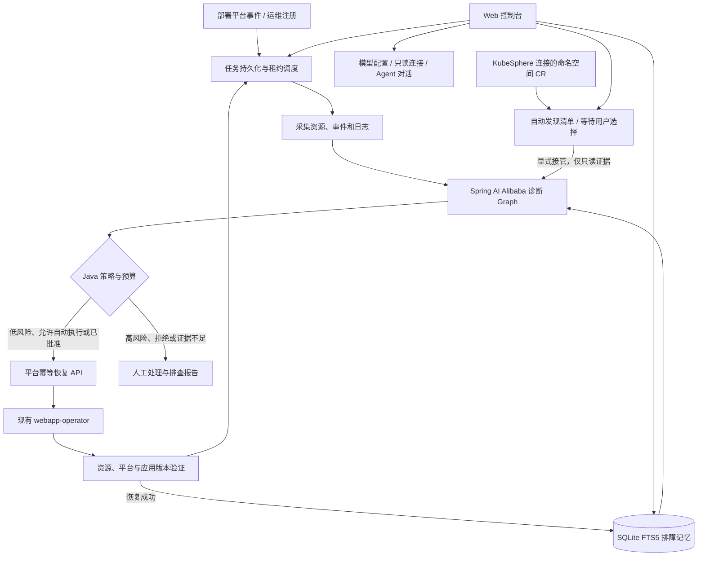
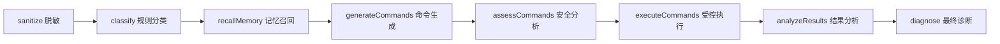

# 部署运维 Agent 项目产品需求文档（PRD）

| 项目 | 内容 |
| --- | --- |
| 文档名称 | 部署运维 Agent 项目 PRD |
| 创建日期 | 2026-11-12 |
| 最后更新 | 2026-11-13 |
| 文档状态 | 当前实现基线；本机模拟与自动化验证通过，真实平台、模型和集群待联调 |
| 项目标识 | deployment-ops-agent |
| 项目位置 | 独立项目 `D:/codes/deployment-ops-agent` |
| 适用读者 | 产品负责人、运维、研发、测试和平台集成人员 |
| 文档范围 | 项目全貌、用户流程、跨模块规则、数据安全和整体验收 |

## 1. 背景与产品目标

现有部署由平台与 webapp-operator 驱动。部署失败后，运维需要查看资源状态、关联事件与日志，判断是否适合重试，再确认平台和应用是否真正恢复。排查结论容易散落在聊天或个人记录中，下一次类似故障仍需重复定位。

本项目提供独立运行的部署运维 Agent，完成“监控 → 采证 → 排查 → 安全判断 → 受控恢复 → 验证 → 经验沉淀”的闭环。模型负责解释与提出建议，Java 策略负责执行授权；部署修改由现有平台和 Operator 执行。

产品目标：

- 自动发现已接入部署的明确失败与阶段停滞，形成可追溯的中文排障方案。
- 针对有充分当前证据的暂时性故障，按预算和手册进行重试，并验证实际发布版本。
- 为运维提供模型配置、KubeSphere 连接、Agent 对话、任务查询与记忆维护页面。
- 将已解决问题沉淀为可检索经验，在后续诊断和对话中展示来源。
- 支持无需 PostgreSQL 的完整 SQLite 单机运行方式。

本版不预设恢复成功率、平均修复时间或吞吐量承诺；上线前以真实环境验收结果建立基线。

## 2. 范围与交付边界

### 2.1 当前支持

| 能力 | 当前交付范围 |
| --- | --- |
| 部署接入 | API 注册、严格部署事件、多连接 CR 发现；可选站点阶段 v1 账本及按范围自动托管，平台生产端待联合验收 |
| 监控对象 | ProjectPostgres、ProjectRuntime、PlatformRelease、ServicePublish 四类 CR |
| 故障诊断 | 当前资源采证、规则分类、记忆召回、模型解释及规则回退 |
| 命令排查 | 可选结构化 kubectl 计划、安全分析、只读执行、结果分析与审计 |
| 恢复 | 通过版本化手册调用平台恢复 API，自动或批准后执行低风险重试 |
| 验收 | CR 当前代次、平台任务、本次恢复身份与应用版本健康联合验证 |
| 控制台 | 六个入口（新增站点开通）、凭据加密、共享运维工作空间 |
| 排障记忆 | 手工、聊天和成功恢复来源，FTS5 检索，可信状态与真实引用 |
| 存储 | 默认 PostgreSQL 主库；可选完整 SQLite 主库；记忆始终采用 SQLite FTS5 |
| 运行保障 | 幂等、租约、预算、步骤时限、追加审计、持久化通知及重启接管 |

### 2.2 当前范围外

不扫描平台未授权部署任务或 KubeSphere DevOps 流水线；可选 v1 阶段流只读取平台授权范围，CR 发现仍仅限已启用连接的明确命名空间，不猜测平台发布任务 ID。不提供任意 Shell、自由 kubectl 参数或聊天直接执行工具；不自动改代码、改配置、扩容、发布新镜像、操作 Secret / PVC、执行数据库回滚或发布回滚。此类需求进入人工变更流程。

不提供多租户、个人会话隔离、统一身份平台、流式回答、向量检索、自动历史清理、已删除发布历史重建或 PostgreSQL → SQLite 自动迁移。页面可按多个只读连接发现当前 CR，每个连接独立选择 1–20 个明确命名空间；一个恢复工作流进程仍只连接一个服务端配置的集群。

站点阶段账本、策略、去重预算、暂停、自动恢复独立开关及本轮边界见[站点开通与自动托管 PRD](站点开通与自动托管_PRD.md)。本期不增加恢复类型，未完成平台阶段生产端、现场恢复验收或候选知识回放发布。

## 3. 用户角色与典型场景

以下为业务职责划分；本版应用内统一使用 OPERATOR 权限，没有分离的管理员与审批员权限体系。

| 角色 | 目标与操作 |
| --- | --- |
| 运维人员 | 查看任务和证据、与 Agent 对话、批准低风险方案、人工处理风险故障、维护记忆 |
| 部署管理员 | 配置服务账号、命名空间、模型、连接、预算、验收目录、数据库与主密钥 |
| 部署平台 | 推送发布事件、提供受权快照、幂等受理恢复并报告结果 |
| 测试与验收人员 | 验证故障分支、身份与预算边界、存储恢复及真实环境集成 |

典型场景：

1. 发布因当前 CR 确认的临时网络超时失败，Agent 采证并生成方案，安全检查后按平台手册重试，连续验证成功后沉淀经验。
2. 发布出现认证错误、OOM 或存储风险，Agent 输出排查步骤并转人工，不因模型或历史经验建议重试而自动操作。
3. 运维关联部署任务和 KubeSphere 连接提问，按需读取只读 Pod 快照，参考已验证案例分析问题。
4. 单机运行 SQLite，保存模型、KubeSphere 连接和聊天；服务重启后继续读取，中文检索历史思路。
5. 运维启用 KubeSphere 连接的 CR 发现，自动获得当前部署清单，选择异常资源交给 Agent 生成方案；其他任务继续等待接管或被忽略，不自动恢复。

## 4. 产品结构与设计原则

- **建议与授权分离**：模型提出原因、步骤和结构化计划，不能修改白名单、预算或执行器。
- **诊断与恢复分离**：Graph 编排诊断；外部恢复由持久化状态机驱动，不能依赖一次模型调用完成全部操作。
- **当前证据优先**：历史记忆和命令结果不能扩大原有恢复授权；新风险可以否决自动动作。
- **先记录再执行**：恢复意图、动作身份、预算和命令审计先落盘；中断后按原身份对账。
- **验证后完成**：请求受理、Pod Ready 或模型声称成功均不能单独结束任务。

技术实现基线为 JDK 21、Spring Boot 3.5.10、Spring AI Alibaba 1.1.2.4-security-fix、Spring AI 1.1.2 和 Fabric8 7.4.0。Agent 独立部署，不要求升级现有 JDK 11 Operator。

## 5. 端到端部署流程

### 5.1 注册与资源发现（DEP-01）

手工注册需提供 requestKey、十进制字符串 provisioningId，以及 1–10 个已存在 CR 的类型、命名空间、名称、UID 和 generation。严格模式另需发布版本和服务端验收目录，并核验平台受权快照。平台 64 位 ID 不能转成 JavaScript number。

同 requestKey、同内容返回原任务；同键不同内容返回冲突。同一平台任务只允许一个活动任务。严格模式同一发布版本共享唯一任务与恢复预算，不能换请求键或事件号重置预算。

部署事件先持久化，再进入 DISCOVERING；目标为空或 targetsComplete=false 时等待，完整受权目标集合可冻结后进入监控。旧任务活动时，新事件持久化等待。发现默认最多等待 10 分钟；长期未创建或前置阶段明确失败时停止自动流程并保留原因。目录冲突事件隔离，不阻塞其他事件。

### 5.2 监控与采证（DEP-02）

默认每 5 秒调度，明确失败或阶段连续 10 分钟无进展触发诊断。采集 CR 状态及沿 ownerReference UID 关联的 Deployment、StatefulSet、Job、ReplicaSet、Pod、事件和有界日志。

每个目标最多采集 4 个 Pod、最多 15 条事件，容器日志最多 60 行 / 4096 字节。没有 CR 所有权链的 Helm 中间件 Pod 不纳入自动日志采集。证据保留来源、UID、代次、时间和采集缺口。

可选采证失败时保留已经获得的证据，并禁止本次自动恢复。API 断连或权限错误不能直接解释为部署失败；连续 3 次接口或采证异常转人工。

### 5.3 诊断、批准与恢复（DEP-03）

诊断输出原因假设、检查步骤、修复步骤、验证方式、来源、记忆引用和命令审计引用。没有模型或诊断模型失败时回退规则手册。

只有当前代次 CR 的明确暂时性故障，例如网络超时、临时 DNS 失败、明确 HTTP 429 / 503 / 504，才可能授权重试；认证、配置、OOM、容量、存储和数据风险优先否决。历史日志和普通数字不能单独授予重试。

默认最多 2 次恢复意图，可配置 1–3 次，采用指数退避与稳定抖动。当前可执行恢复手册为 `platform-transient-retry` v1。Agent 预算不重置 Operator 内部失败预算。

关闭自动恢复时，低风险方案进入 WAITING_APPROVAL；批准必须提交当前 planId，并重新检查时限、证据和资源身份。高风险方案不能通过批准接口变为自动执行。页面当前只展示任务，批准、取消和通知重投通过 API 完成。

### 5.4 平台恢复契约（DEP-04）

严格模式默认开启。恢复请求携带发布版本、snapshotToken、目标 UID / generation、配置摘要、重试序号、验收目录和手册版本。平台需在事务或发布锁内核验，并按 requestKey 幂等受理。409 / 412 或身份冲突停止旧任务，不降级调用旧接口。

动作意图与预算先落盘；响应丢失或进程崩溃后复用原动作键。依赖平台持久化幂等记录，不承诺跨系统 exactly-once。

旧平台兼容试点必须同时关闭严格模式和自动恢复，只允许人工批准；不支持事件发现，不能获得严格模式的原子前提保证。本项目仅交付 Agent 侧，平台扩展未由本项目实现。

### 5.5 验证与结束（DEP-05）

严格模式成功需同时满足：绑定 CR 当前代次全部 Ready、平台任务 SUCCEEDED、本次恢复身份 SUCCEEDED（发生恢复时），以及服务端验收目录的健康响应为 HTTP 成功、status=UP、version 等于绑定发布版本，默认连续 3 次通过。

验证默认最多等待 5 分钟，任务总时限默认 60 分钟。验证前与响应后都检查截止时间，迟到结果不能累计成功。恢复失败按剩余预算重新诊断；身份缺失、被替换或 SUPERSEDED 时停止旧任务。

UID 被替换、资源删除或发生非恢复配置变化时终止旧任务。自身恢复只允许在冻结动作基线上、其他配置摘要不变的一次受控代次与重试序号递增，不能反复接受变化。人工变更后按新发布和新快照重新注册。

### 5.6 任务状态

| 状态 | 含义与主要出口 |
| --- | --- |
| DISCOVERING | 等待完整受权资源集合；就绪转 MONITORING，超时或失败停止自动流程 |
| MONITORING | 观察当前版本；失败或停滞转 DIAGNOSING，就绪转 VERIFYING |
| DIAGNOSING | 运行诊断图；转 RETRY_WAIT、WAITING_APPROVAL 或 MANUAL_REQUIRED |
| WAITING_APPROVAL | 等待当前低风险方案批准；过期转人工 |
| RETRY_WAIT | 等待退避到期，重新核验后持久化动作意图 |
| EXECUTING | 以固定身份提交或对账平台恢复 |
| VERIFYING | 联合验证；可成功、按预算重诊断或停止 |
| SUCCEEDED | 验证通过，终态 |
| MANUAL_REQUIRED | 自动流程停止，需人工处理，终态 |
| FAILED | 任务失败，例如恢复身份被替换，终态 |
| CANCELLED | 运维取消尚未下发动作的任务，终态 |

执行和验证阶段取消请求返回冲突，不能通过取消接口撤销已经发生的外部操作。终态仍可查询。

## 6. 诊断 Graph 与命令安全

### 6.1 八节点流程（GRF-01）

| 节点 | 产品责任 |
| --- | --- |
| sanitize | 脱敏本次证据，降低凭据进入模型和报告的风险 |
| classify | 只依据本次采证确定原始动作权限 |
| recallMemory | 召回当前运行环境最多 3 条已验证案例，保留真实引用 |
| generateCommands | 根据证据、参考案例和服务端目录生成结构化只读计划 |
| assessCommands | Java 独立检查白名单、范围、标识、数量并生成固定参数 |
| executeCommands | 先保存审计，再核验租约和身份，按有界执行器采证 |
| analyzeResults | 汇总执行状态与新证据；只能维持或降低原权限 |
| diagnose | 形成中文原因、步骤与验证方式，附记忆和命令审计引用 |

命令功能关闭时节点保留，跳过实际命令采证。Graph 异常转人工。不同任务的范围与授权上下文必须隔离，不能继承前次调用；当前每实例诊断图调用串行，等待可被中断。

### 6.2 命令生成与安全门禁（CMD-01）

命令功能默认关闭。DEMO 开启后仅模拟，不启动本机 kubectl。模型只能返回 operation、subjectId、purpose；不能返回可直接执行的 Shell 或自由参数。模型不可用或结构异常时回退固定模板；安全拒绝后不能通过模板绕过拒绝。

服务端目录仅包含任务绑定 CR 与沿所有权 UID 关联的 Pod；每目标最多 4 个 Pod、每 Pod 最多 4 个普通或初始化容器。允许 GET、DESCRIBE、EVENTS、LOGS；日志必须指定目录中的 Pod 和容器，事件按 involvedObject.uid 过滤。

Java 校验目录归属、允许命名空间、资源类型、标识格式和命令数量。禁止 Secret、exec、apply、patch、delete、插件、watch、任意 flags、管道、重定向和集群切换。最终 argv 由 Java 组装，ProcessBuilder 直接调用，不经过 Shell。

每个故障证据快照最多 3 条命令；超预算整批拒绝。单条进程最长 5 秒、请求超时固定 4 秒，合并原始输出最多 8192 字节，脱敏后最多保存 4000 字符；命令阶段在请求边界检查 45 秒预算。超时、中断或超限终止进程，子进程不继承模型和平台密钥环境。

### 6.3 身份、审计与中断（CMD-02）

真实模式须显式配置现存 kubectl 绝对路径、专用 kubeconfig 和 context。Fabric8 与 CLI 使用相同启动冻结身份，拒绝 HTTP、跳过 TLS、exec / auth-provider 插件或不存在的 context。文件变化后停止命令采证，核对后重启。页面 KubeSphere 连接不切换此身份。

执行前保存安全结果和意图，原子认领后启动；每条执行前后核验资源 UID，替换时丢弃输出。所有状态写入绑定当前 DIAGNOSING 任务租约。

状态为 APPROVED / REJECTED、RUNNING、SUCCEEDED / FAILED / TIMED_OUT / OUTPUT_LIMIT。已有批次重入复用审计；中断的 APPROVED / RUNNING 视为 UNKNOWN 并转人工，不自动重放，不伪造完成状态。

任何拒绝、失败、超时、输出不完整或状态不明均否决自动恢复。成功命令中的新风险也可否决；命令结果不能将人工动作提升为自动重试。只读查询存在身份核验与读取间的并发窗口，不能单独授予恢复权限。

## 7. Web 控制台

### 7.1 信息架构（UI-01）

| 入口 | 主要内容与操作 |
| --- | --- |
| Agent 对话 | 新建 / 切换会话、关联任务与连接、按需读取快照、问答及来源引用 |
| 排障记忆 | 中文检索、可信状态过滤、记录、编辑、核实、归档和恢复 |
| KubeSphere 连接 | 增删改查连接、测试只读访问、打开控制台链接 |
| LLM 设置 | 协议、地址、模型、密钥、采样参数、启用与连接测试 |
| 部署任务 | 独立多命名空间发现与每页 30 条清单、案例证据 / 对话 / 总结、严格恢复转交和批准 / 停止；已有 Run 最近 30 条及命令审计；DEMO 可创建演示任务 |

页面与后端打包，无需独立前端服务或 CDN。桌面侧栏、窄屏导航可滚动；错误显示在对应表单，保存失败保留输入，无结果展示空态。

### 7.2 模型配置（UI-02）

支持 DashScope 原生与 OpenAI 兼容协议。配置启用开关、Base URL、模型名、API Key、Temperature（0–2）、最大输出 Token（128–4096）。默认 qwen-plus、0.1、1500，未启用。

模型名称旁可获取当前网关目录并从下拉框选择，也可手填。获取使用当前未保存地址与新填密钥，不修改配置；留空仅能复用相同协议、地址及版本的已保存密钥。目录去重排序，最多 500 项、响应上限 1 MiB；失败或无模型时保留手填，地址 / 协议 / 密钥改变后原列表失效。选择后保存并测试实际可用性，目录展示不保证上游账号支持推理。兼容协议请求 `/models`，原生 DashScope 请求 `/compatible-mode/v1/models`，均不跟随重定向或返回上游错误正文。

保存后对后续对话与诊断生效。页面配置优先于启动模型配置；明确关闭后诊断使用手册。尚未保存页面配置时诊断兼容启动配置，对话使用规则助手。连接测试会产生实际模型调用，即使模型开关关闭也可测试已保存配置。

密钥留空保留、勾选才清除，不回显；更换地址或协议须重输或清除原密钥。配置使用 revision 防覆盖。默认 HTTPS，不跟随重定向；本机替身可由服务端显式允许 HTTP。

### 7.3 KubeSphere 连接（UI-03）

连接字段包括名称、Kubernetes API 网关、可选控制台链接、命名空间、Token 和可选 PEM CA 证书。完整 SQLite 模式下这些字段与加密 Token / CA 全部入主文件，重启保留。

测试读取 `{apiUrl}/api/v1/namespaces/{namespace}/pods?limit=10`，最多返回 10 个 Pod 的名称、phase、Ready 条件与采集时间。API 基址可包含集群代理前缀；HTML 控制台地址不能代替 API 网关。测试成功仅证明该只读访问可用。

Token 留空保留、显式清除、不回显；更换 API 地址须重输或清除。删除连接解除历史会话关联，保留历史文本。页面连接不改变工作流平台凭据、集群身份和允许命名空间。

CA 最多 32768 字符、10 张 X.509 CA 证书，拒绝私钥和叶子证书。证书加密保存、不回显，留空保留、显式清除；更换 API 地址须重新提供或清除。自定义信任仅作用于该 HTTPS 连接，证书链和主机名始终校验；旧连接未配 CA 时使用系统信任。

### 7.4 Agent 对话（UI-04）

勾选“自动只读排查”后先执行 `generateCommands → assessCommands → executeCommands → analyzeResults`，使用所选连接实际读取状态、事件和有界日志，再分析。计划为服务端固定只读模板，无额外模型规划调用；可展开本轮请求和独立证据，模型失败也保留。403 明确资源权限，重放不执行，身份变化及租约过期停止；完整规则见《对话只读排查 PRD》。

成功助手回复及历史成功回复支持安全 Markdown，包含段落、换行、标题、列表、引用、强调、行内代码、代码块和表格；用户、失败及处理中消息保持纯文本。长代码 / 宽表格在消息内滚动。HTML 仅按文字展示、图片不自动加载、仅不含账号密码的完整 HTTP / HTTPS 链接可点击。渲染异常降级为原文，存储内容与记忆来源不变，详细规则见《Agent 管理控制台 PRD》。

会话可关联一个任务和一个只读连接，环境关联固定；切换环境新建会话。单条问题最多 4000 字符。未关联时提供受字符预算限制的安全连接目录，最多 10 条，供用户选择，目录不代表实时健康且不触发集群请求。关联后始终提供名称、ID、API、控制台地址与命名空间，不提供凭据；页面选择连接、恢复已绑定历史会话或从发现任务进入时默认勾选本轮自动只读排查，用户仍可关闭，API 按 includeCluster 执行。

本轮连接和快照优先于长任务方案，模型参考最近最多 6 个成功轮次、本轮上下文及最多 3 条已验证记忆。快照失败标记采集缺口，仍可根据已有配置和任务对话；发现身份失效仍拒绝，不读替代环境。

无模型时显示规则助手；模型失败保存失败轮次，区分认证、权限、模型不支持、限流 / 额度、超时、网络 / TLS、上游故障与异常响应，展示本地错误类别及可用 HTTP 状态，服务端仅记录类别、状态和耗时，不记录原异常正文。失败消息可“重新提问”填回输入区，用户确认发送才产生新请求；不自动重发。对话可执行有审计的只读 Kubernetes API 采证，不创建恢复动作，不执行自由 Shell 或写入命令。成功回复可保存为待确认思路，来源绑定真实轮次，同轮次重复保存不重复创建。

同请求身份重放返回已有结果，内容变化拒绝；同一会话串行，默认 4 个聊天槽位，90 秒租约过期后允许接管，迟到结果不能覆盖新状态。列表展示最近 50 个会话、每会话最近 50 轮；历史不自动清理，回复非流式。

### 7.5 部署发现与手动接管（UI-05）

部署任务页分为集群部署发现和已接入恢复流程。来源默认关闭，运维按连接启用，后台每 30 秒调度 get / list 四类 CR；首次同步收录当前资源，按连接、目标摘要、UID 与 generation 去重，新代次分别记录。页面区分集群状态与 Agent 状态，支持筛选、分页、忽略与手动接管。

接管持久化 requestId、revision、选择人及时间，后台持有租约、前后核验资源后走现有诊断 Graph 的证据入口；命令节点跳过、方案 automatic=false，不创建恢复任务。用户未选择时不调用模型；失败不自动重放。询问 Agent 时固定发现记录与同一连接，不能混用其他连接或 runId。删除连接保留历史，换址、资源替换和旧代次拒绝继续排查。

发现清单与来源配置存储于所选主库。读取错误不伪造删除，原始 spec 与凭据不入摘要；CR Ready 不等于平台 / 应用成功。范围与非功能约束见 [部署发现与手动接管 PRD](部署发现与手动接管_PRD.md)。

## 8. 排障记忆与检索

### 8.1 数据与生命周期（MEM-01）

| 字段 | 规则 |
| --- | --- |
| 标题 | 必填，最多 120 字符 |
| 问题现象 | 必填，最多 4000 字符 |
| 原因分析 | 最多 4000 字符 |
| 解决步骤 | 必填，最多 4000 字符 |
| 验证依据 | 最多 4000 字符；标记已验证时必填 |
| 标签 | 最多 300 字符 |
| 状态 | DRAFT 待确认、VERIFIED 已验证、ARCHIVED 已归档 |
| 来源与版本 | 服务端记录 MANUAL / CHAT / RUN / REFLECTION、来源身份和 revision |

手工及聊天默认待确认，可搜索和编辑但不自动召回。人工填写依据并确认后成为已验证；归档退出有效检索和召回，可编辑恢复。并发编辑返回 409，不静默覆盖。来源身份不能在编辑中改写。

经过恢复（attempts > 0）、具有诊断方案且最终成功的任务自动生成 RUN 已验证案例。任务成功与出队记录同事务提交，每 5 秒处理最多 10 条，失败延迟 60 秒继续。重复归档不能覆盖人工修改或复活已归档案例；未恢复的成功任务、失败 / 转人工 / 取消任务生成 DRAFT 复盘，不自动确认为成功案例；升级前旧任务不自动回填。关联成功对话和完成调查也保存待确认总结，详情见《自动复盘与学习 PRD》。

### 8.2 FTS5 与召回（MEM-02）

采用 SQLite FTS5、中文双字组和技术词 / 驼峰拆词，支持中文现象与 ImagePullBackOff 等检索。搜索词最多 500 字符，参数化处理，不开放 SQL 或 FTS 运算符。默认有效结果最多 50 条，支持状态过滤；空查询按更新时间展示。

Graph 与聊天按实际来源范围自动召回最多 3 条 VERIFIED，保存真实 ID、标题和来源。模拟为 DEMO，真实为规范化 API 与实际 namespace 摘要；无来源不自动召回，仍是共享运维空间而非多租户权限系统。词法相关不代表根因相同，引用也不代表模型采用全部建议。

历史经验不能改变本次分类、批准、预算或验收标准。召回故障时继续基于本次证据诊断；记忆内容不提供执行授权，模型没有自动确认或编辑记忆的工具。

## 9. 存储、数据与备份（DAT-01）

| 数据 | PostgreSQL 模式 | 完整 SQLite 模式 |
| --- | --- | --- |
| 任务、事件、预算、恢复身份 | PostgreSQL 主库 | `./data/agent.db` |
| 状态审计、命令审计、通知 | PostgreSQL 主库 | 同一主文件 |
| LLM、KubeSphere、聊天 | PostgreSQL 主库，凭据加密 | 同一主文件，凭据加密 |
| 排障记忆与 FTS5 | `./data/agent-memory.db` | 同一主文件 |
| 记忆出队记录 | PostgreSQL 主库 | 同一主文件 |

SQLite 通过 sqlite profile 启用，使用 WAL、外键和 IMMEDIATE 写事务，仅支持本地持久盘单机单实例。PostgreSQL 模式的本版记忆文件同样按单实例部署设计，不承诺多副本共享记忆。切换 profile 不搬迁数据。

任务快照保留最近最多 100 条状态事件，独立审计追加保存；命令审计、通知、聊天、记忆及发布去重账本不自动清理。追加审计不等于抗数据库管理员篡改。

API Key 与 Token 使用 AES-256-GCM 加密。生产通过 Secret 或受限文件注入 32 字节主密钥；本机可首次生成 `./data/console-master.key`。数据库、独立记忆文件及主密钥配套备份；SQLite 在线备份使用 backup API，或停服后复制，不能遗漏 WAL。密钥丢失后需恢复原密钥或重填凭据。

## 10. 权限、安全与配置治理（SEC-01）

所有业务 API、配置和指标需要 OPERATOR 认证，公开静态登录壳与简略健康端点。当前使用 HTTP Basic，真实模式禁止演示密码，对外访问通过 HTTPS 和受控网络提供。浏览器凭据只驻留内存，刷新重新登录。所有操作员共享数据域。

控制台写请求必须携带 `X-Console-Request: 1`，有 Origin 时核对同源。成功助手回复仅展示净化后的 Markdown 排版元素，其他动态文本按纯文本呈现，配置 CSP。凭据不通过 GET、错误正文或输入框回显。平台 Token 不携带到应用健康请求；请求不跟随重定向。

模型、日志、历史记忆与命令输出均按不可信内容处理。脱敏降低泄露风险，但不保证覆盖全部业务隐私；外部模型可发送范围需现场审查。服务账号使用命名空间只读 RBAC，不授予 Secret、exec 或资源写权限。平台写入只允许受控恢复契约。

`BUSINESS_DICTIONARY_OR_CONFIG`：任务 / 命令 / 记忆状态、动作类型、CR 类型和安全白名单为代码枚举或版本化策略；预算、时限、并发、平台地址、命名空间与验收目录为服务端配置；模型与只读连接为在线运维配置；记忆正文是参考知识，不能充当执行策略。

安全参考采用 Kubernetes [RBAC 最佳实践](https://kubernetes.io/docs/concepts/security/rbac-good-practices/)、OWASP [命令注入防御](https://cheatsheetseries.owasp.org/cheatsheets/OS_Command_Injection_Defense_Cheat_Sheet.html)、[密钥管理](https://cheatsheetseries.owasp.org/cheatsheets/Secrets_Management_Cheat_Sheet.html) 和 [CSRF 防御](https://cheatsheetseries.owasp.org/cheatsheets/Cross-Site_Request_Forgery_Prevention_Cheat_Sheet.html)；本项目不据此宣称组织级安全认证。

## 11. 接口与外部依赖（INT-01）

| 接口组 | 主要路径与语义 |
| --- | --- |
| 任务 | `POST /api/runs` 注册；`GET /api/runs` 列表；`GET /api/runs/{id}` 详情 |
| 人工控制 | `POST /api/runs/{id}/approve` 按 planId 批准；`POST /api/runs/{id}/cancel` 取消 |
| 事件与手册 | `POST /api/deployment-events`；`GET /api/deployment-events/{eventId}`；`GET /api/runbooks` |
| 审计与通知 | `GET /api/runs/{id}/audit`、`/commands`、`/notifications`；`POST /api/notifications/{id}/redeliver` |
| 控制台配置 | `GET /api/console/bootstrap`；`GET/PUT /api/console/llm`；`POST /api/console/llm/test` 测试；`POST /api/console/llm/models` 按当前表单获取目录，不保存配置 |
| 连接 | `/api/console/connections` 列表 / 创建；`/{id}` 更新 / 删除；`/{id}/test` 测试 |
| 对话 | `/api/console/sessions` 列表 / 创建；`/{id}/turns` 历史；`/{id}/messages` 发送 |
| 部署发现 | `/api/console/discovery/sources` 查询与 `/{id}` 配置、`/{id}/sync` 同步；`/tasks` 分页、`/{id}` 详情、`/{id}/select` 手动排查、`/{id}/ignore` 忽略 |
| 记忆 | `GET/POST /api/console/memories`；`GET/PUT /api/console/memories/{id}` |
| 服务状态 | `GET /actuator/health` 简略健康；认证后访问指标 |

注册成功返回 202；同请求内容冲突、过期方案、revision 冲突等返回 409。列表 API limit 最大 100；页面任务固定展示最近 30 条；命令查询最多 100 条。完整字段以专项 PRD、请求示例及契约文档为准。

外部依赖包括 Kubernetes API、四类 Operator CR、平台受权快照和恢复接口、任务验收端点、可选模型服务与可选通知接收端。严格平台接口为 `GET /provisioning-instances/{id}` 和 `POST /provisioning-instances/{id}/agent-recoveries`；旧接口为受限兼容试点 `/retry`。

## 12. 运行、通知与异常恢复（OPS-01）

默认每实例 4 个工作槽位，可配置 1–32；先预留槽位再认领任务，不排队占用额外租约。独立心跳续租和独立单步定时器；单步默认 75 秒、采证默认 45 秒。租约默认 5 分钟，配置不能小于 120 秒；过期 owner 不能写结果。

超时中断后，工作线程真实退出才释放槽位；不通过无限新建线程绕过上限。续租失败停止后续外部动作。重启后接管到期租约、复用原恢复身份，不自动重放状态不明的命令。

WAITING_APPROVAL 与终态转换同事务记录通知出队事件。默认关闭投递；开启后向服务端固定 HTTPS 地址发送 HMAC-SHA256 签名通知，正文不带日志或凭据。默认最多 8 次，失败退避、耗尽 DEAD，人工重投保留事件身份。投递语义至少一次，接收方核验时间窗口与签名并去重。

| 异常 | 处理要求 |
| --- | --- |
| 模型诊断失败 / 命令计划无法解析 | 规则手册 / 固定模板回退，安全策略仍生效 |
| 聊天模型失败 | 保存失败轮次，展示安全错误，不伪造回答 |
| 记忆检索故障 | 不引用历史，继续当前证据诊断 |
| 记忆归档失败 | 保留出队记录延迟重试，不回滚成功任务 |
| 命令拒绝 / 失败 / 不完整 / 未知 | 保存审计并否决自动恢复 |
| 当前方案过期或证据变化 | 拒绝原批准或动作，保留原因 |
| 目标 / 发布 / 恢复身份变化 | 停止旧任务，禁止替代身份继续执行 |
| 数据库认领或租约失败 | 不启动后续操作，不绕过约束 |
| 真实模式配置不合法 | 启动阶段失败，不让调度器带错误配置运行 |

## 13. 默认值与部署要求

| 参数 | 默认值或约束 |
| --- | --- |
| 运行模式 / 地址 | DEMO；127.0.0.1:8098 |
| 主存储 | PostgreSQL；可选 sqlite profile |
| 自动恢复 | 应用默认 true；Kubernetes 部署示例 false，现场先验证严格契约 |
| 严格契约 | true；兼容试点必须同时关闭自动恢复 |
| 恢复次数 / 稳定检查 | 2 次，可配 1–3；连续 3 次验证 |
| 轮询 / 停滞 / 总时限 | 5 秒 / 10 分钟 / 60 分钟 |
| 资源发现 / 验证等待 | 10 分钟 / 5 分钟 |
| 命令执行 | 默认关闭；最多 3 条，单条最多 5 秒 |
| 模型与通知 | 默认未启用；控制台模型读取超时默认 45 秒，AGENT_MODEL_READ_TIMEOUT 可配置 100ms–45s；单次尝试 |

本机支持 JDK 21 Jar 运行；容器需持久数据卷并保证运行 UID 可读写。SQLite 与本版共享记忆方案按单实例部署，Kubernetes 示例为 Recreate。真实 CLI 需部署方安装官方 kubectl 并匹配集群版本，当前 Jar / 镜像不内置。

真实模式必须配置独立 API 凭据、平台 Token、HTTPS 平台与验收地址、受限命名空间和验收目录；开启 CLI 另需专用冻结身份。多工作流集群采用独立部署和独立任务数据域。

## 14. 验收标准与证据

| 编号 | 验收条件与预期 | 需求映射 |
| --- | --- | --- |
| AC-01 | 重复注册返回原任务，同键不同内容拒绝；超安全整数平台 ID 原样保存 | DEP-01 |
| AC-02 | 重复事件 / 新请求键不能重置同发布预算；完整资源集合前不进入监控 | DEP-01 |
| AC-03 | 明确失败或阶段停滞触发诊断；采证缺口保留且不授权自动恢复 | DEP-02 |
| AC-04 | 暂时性当前证据可进入低风险方案；认证、OOM、存储风险及历史建议不能授权重试 | DEP-03、SEC-01 |
| AC-05 | 旧 planId 或过期批准拒绝；批准后当前风险变化仍能阻止执行 | DEP-03 |
| AC-06 | 响应丢失沿用原动作键与预算；严格契约冲突不调用旧接口 | DEP-04 |
| AC-07 | CR 旧代次、应用 DOWN、版本错误或恢复身份不符均不能成功；连续验证通过才结束 | DEP-05 |
| AC-08 | Graph 按八节点执行，无模型与关闭命令均能诊断；跨任务和并发范围隔离 | GRF-01 |
| AC-09 | 危险操作、未知目录 ID、跨命名空间、注入标识及超预算计划拒绝 | CMD-01 |
| AC-10 | 参数字面传递，无 Shell；进程超时 / 中断 / 输出超限终止，结果不授予新权限 | CMD-01、CMD-02 |
| AC-11 | 两种主库先存审计再执行；重入不重复执行，未知状态转人工，过期 owner 不可回写 | CMD-02、DAT-01 |
| AC-12 | 五个页面入口可用，任务详情展示命令安全理由及脱敏结果；窄屏可操作 | UI-01 |
| AC-13 | 保存模型后对后续诊断生效，密钥不回显；可获取目录并选择或手填，获取不保存配置；版本冲突与更换地址凭据规则生效 | UI-02 |
| AC-14 | SQLite 保存 KubeSphere 完整连接与加密 Token / CA，重启保留；指定命名空间 Pod 可读取，错误 CA 或主机名必须拒绝 | UI-03、DAT-01 |
| AC-15 | 对话关联、历史和记忆引用保留；请求重放不重复调用，迟到回复不覆盖新轮次 | UI-04 |
| AC-16 | 中文与技术词可检索；DRAFT 不召回，VERIFIED 可引用，ARCHIVED 退出召回 | MEM-01、MEM-02 |
| AC-17 | 同来源幂等、revision 冲突拒绝；成功恢复归档一次，不覆盖人工编辑或复活归档案例 | MEM-01 |
| AC-18 | 无 PostgreSQL 可启动 SQLite；两种主库保持认领、预算、通知与审计契约 | DAT-01 |
| AC-19 | 匿名业务请求、缺控制台写头请求拒绝；页面、接口与日志不暴露原始凭据 | SEC-01 |
| AC-20 | 发现来源显式启用；相同代次去重，未选择不诊断；手动接管幂等、只读、过期结果不可覆盖；两种主库持久化与对话关联 | UI-05 |
| AC-21 | 无槽位不认领，续租失败阻止后续动作；通知失败退避、耗尽 DEAD，重投身份不变 | OPS-01 |
| AC-22 | 对话安全目录无集群请求；选择后默认快照可关闭，采集失败有缺口提示；LLM 分类错误持久化，失败不自动重发，手动重新提问须确认发送 | UI-04 |
| AC-23 | 新旧成功助手回复安全展示 Markdown 段落、列表、代码和表格；宽内容局部滚动；注入、危险链接及远程图片不能执行 / 加载，依赖异常保留原始文本 | UI-04 |
| AC-24 | 对话实际采证且先存审计，失败模型仍可查看证据；403 标明资源权限，替换 UID、换址、过期与并发隔离生效 | UI-04 |

截至 2026-11-13，最近一轮 JDK 21 / Maven verify 为 **258 项测试，0 失败、0 错误、0 跳过**，覆盖真实 PostgreSQL、真实 SQLite 文件、受控 Java 子进程、HTTP / HTTPS 契约、部署发现、对话上下文、模型分类错误、经验反馈与 Graph 回归。页面完整恢复、验收及经验反馈流程已使用独立DEMO验证；租户两条启用连接另行完成真实 Pod 只读检查。真实 sub2api 的 gpt-6.1-sol 已完成上海站点只读Graph调查，取得RabbitMQ失败Job和容器退出码；事件和日志仍有403采证缺口。

真实 sub2api 页面已读取 28 个模型，完成下拉选择、保留当前模型和换址凭据保护检查。原生 DashScope 目录仅做本机契约验证；真实 kubectl 与平台恢复仍未验收。用户已选择本机8081平台目录联调：仅只读目录可显式允许明确回环IP的HTTP地址，仍需正常平台授权；恢复模式继续要求HTTPS。Windows接入脚本支持系统5.1和7，先验证目录再按当前用户加密保存已有Token，失败不覆盖旧凭据，四条启动路径32项检查通过。真实授权目录4条、单条详情和上海现有CR映射已通过；Agent尚待重启后验证目录同步，启动入口备份逻辑5项及双版本语法已检查，未宣称启动入口已实跑。详细记录见 [验证记录](../../docs/验证记录.md)、[本机目录联调](../../docs/本机平台目录联调.md) 和 [连接导入记录](../../docs/租户KubeSphere连接导入记录.md)。

## 15. 现场验收与后续范围

上线前必须核对真实只读账号、证书、命名空间、四类 CR 状态和所有权链；验证平台原子核验、持久化幂等、Operator 消费确认、预算互斥及应用版本健康端点。开启 CLI 时另验 kubectl 版本、冻结 context、输出限制和真实资源替换分支。

模型现场验收包含两种协议路径、模型输出格式、错误回退和可外发日志范围。运维验收包含数据库 / 主密钥备份恢复、持久卷权限、通知签名与重复投递，以及进程重启接管。

未纳入本版的后续候选包括：组织身份与多租户隔离、向量召回、历史保留与归档策略、数据迁移、流式聊天，以及具有平台执行与补偿契约的扩容 / 回滚 / 配置修复。以上尚未排期，也不属于当前已交付能力。

## 16. 文档导航与维护

本文件作为项目级阅读与验收入口；专项 PRD 承载对应模块细则。跨模块规则变更须同步总 PRD 与相关专项文档，不以历史验证记录替代当前需求。

| 文档 | 用途 |
| --- | --- |
| [部署自愈 Agent PRD](部署自愈Agent_PRD.md) | 任务生命周期、恢复、批准与验收细则 |
| [管理控制台 PRD](Agent管理控制台_PRD.md) | 页面、模型、连接和会话规则 |
| [部署发现与手动接管 PRD](部署发现与手动接管_PRD.md) | 多连接 CR 发现、去重、用户接管与只读方案 |
| [SQLite 与排障记忆 PRD](SQLite与排障记忆_PRD.md) | 存储、可信状态、来源与 FTS5 |
| [kubectl 受控排查 PRD](kubectl受控排查_PRD.md) | 命令范围、安全检查、进程与审计 |
| [平台严格契约与通知接入](../../docs/平台严格契约与通知接入.md) | 平台请求响应、原子事务和签名要求 |
| [README](../../README.md) | 构建、启动、配置和接入说明 |
| [验证记录](../../docs/验证记录.md) | 实际执行证据与未验证边界 |

## 调查案例的衔接规则

发现按连接明确的 1–20 个 namespace 清单运行，与默认 namespace 分离；全范围扫描成功才提交清单。发现记录 ID 是调查案例 ID，关联目标证据、Graph 方案、对话、总结及经显式转交后的 Run 和命令审计。调查与关联对话采集归属工作负载、容器状态、事件和有界日志；普通连接对话现在执行只读排查 Graph，详细采样最多 2 个异常优先 Pod 的容器、事件和日志，详情见《对话只读排查 PRD》。连接测试仍最多读取 10 个 Pod 的摘要。缺口单独显示。

恢复转交先从平台读取生命周期版本与验收目录，预览完整目标，再由用户确认；必须严格 Kubernetes 模式、同集群独立执行身份、目标 namespace 全部受权及服务端验收目录。发布身份与完整目标由平台复核，不能通过模型猜测或使用页面只读凭据。既有发布账本即使终态也复用，不重置预算；案例可批准当前低风险方案或停止尚未执行的动作。原对话可查看关联恢复状态，建议与实际动作分开呈现。完整规则见《部署发现与手动接管 PRD》；平台严格契约仍须独立接入验收。

## 当前平台目录与修复验收

可选的受权平台分页目录保存站点到任务、项目、集群和 namespace 的映射，支持前置阶段展示及用户显式加入监控；后台发现不调用模型，也不自动恢复。严格执行核对平台集群 API，并将生命周期版本与实际应用版本分别绑定；普通任务与案例均有批准和停止入口。

自动经验只认可信恢复凭据和稳定验收，保留原故障；自然收敛为 DRAFT。多空间使用本空间摘要召回，辅助记忆失败不阻断主案例。诊断和命令规划保留安全模型错误分类。

只读目录详情与恢复快照分离，缺少恢复验收配置不再阻断只读关联。任务页显示接入配置和历史扫描状态，不把已保存配置称为连通性已验证或全链路就绪。经验引用保存版本，并支持有帮助、本次不适用和已过期反馈；已过期经验退回待确认后停止召回，重新验证后才可继续使用。

本机完整流程、真实模型与集群只读调查、平台现场恢复分别验收。当前运行与未完成的环境条件以 [评审修复与剩余问题](../../docs/代码评审修复与剩余问题-2026-11-13.md) 为准；测试通过不代表真实恢复已经启用。
